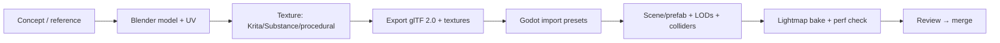

# ASSET_PIPELINE

> **Status:** PLANNED — the tooling/process described here does not exist yet.

## 1. Flow

## 2. Source vs game assets

| Type | Source (LFS) | Game |
|---|---|---|
| Models | `.blend` in `art_source/` (outside `game/`; optional, DD-010) | `.glb` in `res://assets/` |
| Textures | `.kra/.psd/.sbsar` | `.png` (lossless source) → VRAM compressed on import |
| Audio | DAW sessions, 48k/24-bit WAV | `.ogg` (SFX/VO/music); WAV only for tiny UI hits if needed |
| UI | SVG/Affinity | SVG→PNG at needed resolutions, or Godot-native styleboxes |
| Fonts | OFL TTF/OTF | Imported as `FontFile` |

## 3. Modeling export checklist

- Apply transforms; Y-up; 1 unit = 1 m; origin at logical pivot.
- Names per NAMING_CONVENTIONS (`prop_chair_wood_a`).
- UV0 = materials, UV1 = lightmap (non-overlapping).
- Collision meshes named `*_col` (convex) or use simple primitives in Godot.
- LODs named `_lod0/_lod1/_lod2` (or Godot auto LOD).
- Max 25k tris hero / 3k set dressing.

## 4. Texture standards

| Map | Format | Notes |
|---|---|---|
| Albedo | sRGB PNG | No baked lighting |
| Normal | PNG, OpenGL (+Y) | Godot-compatible |
| ORM | PNG linear (R=AO, G=Roughness, B=Metal) | Packed |
| Emission | sRGB | Lamps only |
| Size | 1K kit/prop, 2K hero | Powers of two |

Import presets: VRAM Compressed (BPTC high-quality for normals/hero; S3TC for others), mipmaps on, `detect 3D` on.

## 5. Godot import settings

- Scenes imported as `.glb` with: generate lightmap UV2 off (we author UV2), root type Node3D, no embedded materials (use material library `.tres`).
- Animation: import as `AnimationLibrary`, loop flags per action.
- Import presets are saved in Godot's own `.import` files, committed next to each asset. Non-default presets are documented here and checked by `tools/asset_tools/validate_assets.py` (planned).

## 6. Audio pipeline

1. Record/design at 48 kHz/24-bit.
2. Edit, normalize per bus targets (AUDIO_DESIGN §2).
3. Export Ogg Vorbis (SFX q6, VO/music q7), loop points embedded (or via Godot loop offsets).
4. Naming `sfx_door_wood_open_01.ogg`.
5. Register in `res://resources/game_data/audio/audio_events.tres` (event → stream pool, bus, volume, pitch variance).

## 7. Sourcing and licensing

| Source | License type | Usage rule |
|---|---|---|
| Own creations | Owned | Preferred |
| ambientCG, Poly Haven | CC0 | Allowed; log in ledger |
| Kenney and similar | CC0 | Allowed for placeholders/utility |
| Freesound | Varies (CC0/CC-BY/CC-BY-NC) | **CC0/CC-BY only**; avoid NC; keep attribution |
| Purchased packs (e.g., Sonniss, Unreal/Fab marketplace) | Commercial EULA | Verify redistribution in games; store receipts |
| AI-generated assets | Policy: **not used** in shipped content | Avoid legal/identity risk and aesthetic goal |
| Fonts | OFL / Apache | Verify; bundle license text |

`ASSETS_LICENSES.csv` (repository root; DD-013) columns: `Asset, Category, Source, Author, License, License URL, Usage Rights, Attribution Required, Attribution Text, Notes`. `Asset` is the repository-relative path; `Notes` holds the acquisition date and the proof file. The file contains headers only until assets exist. A CI check (planned) requires every file under `game/assets/` to have a row.

## 8. Placeholder policy

Prefix `TMP_`; tracked by a placeholder report generated by `tools/asset_tools/` (planned); must reach zero at M8.

## 9. Review gates

| Gate | Check |
|---|---|
| Model review | Budgets, scale, UVs, naming |
| Material review | Palette conformity, wear |
| In-engine review | Lighting, silhouette, perf impact |
| License review | Ledger row present |

## 10. Tools

- `tools/asset_tools/validate_assets.py` (planned): checks naming, sizes, missing license rows.
- `res://scripts/utilities/prewarm_list.gd` (planned): generates per-level material prewarm lists.
- Blender batch glTF export script with naming checks (planned, `tools/asset_tools/`).

## 11. Acceptance criteria

- A new prop can go from Blender to a level in < 30 min following this doc.
- No asset without license row at any milestone.
