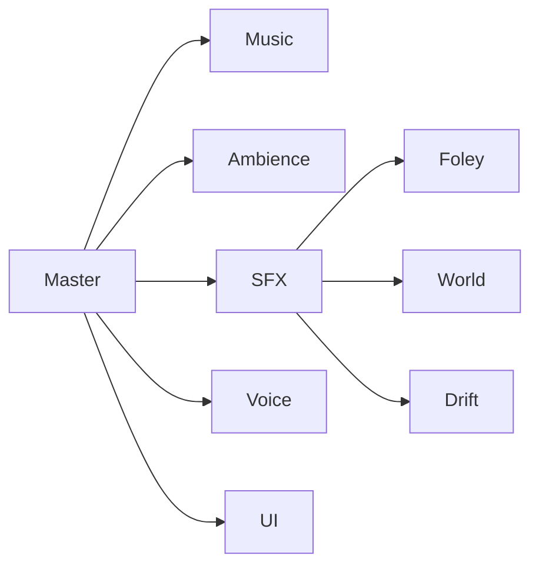

# AUDIO_DESIGN

> **Status:** DESIGNED — specification only; not yet implemented in `game/`.

Audio is half the deception system. It must be **precise**: when audio contradicts vision, there must be a consistent, discoverable reason (R12; L03 is the template).

## 1. Principles

1. Every sound has a source in the world or is explicitly out-of-world (UI/assist).
2. Silence is an instrument; use it before reveals.
3. Contradictions are **authored**, rare and explainable.
4. Captions describe the sound heard, not the world state (R12).
5. Mix for headphones first, stereo speakers second.

## 2. Bus layout

| Bus | Effects | Notes |
|---|---|---|
| Voice | EQ (warm), light compressor, per-room reverb send | Clerk intelligibility priority |
| Ambience | Room-tone beds; non-`listenable` sources attenuate −6 dB while Listen is held (§7) | Room tone beds |
| Foley | Footsteps, cloth, props | Surface-aware |
| World | Doors, machinery | Positional |
| Drift | Anomalous layers | Ducked by Voice |
| UI | Dry | Out-of-world sounds in separate pitch/timbre |
| Music | Sparse, sidechain-ducked by Voice | Often absent |

Loudness targets: dialogue −18 LUFS integrated in-game mix; peaks ≤ −1 dBTP; Music ≤ −24 LUFS typical.

## 3. Content layers

| Layer | Description |
|---|---|
| Room tone | 60–90 s loops per room family (low-frequency HVAC, tubes hum) |
| Environmental | Clocks, pipes, paper, distant typing (randomized, spatialized) |
| Footsteps | Surfaces: travertine, linoleum, concrete, wood, metal grate, carpet; 6 variants each; reverb per room |
| Interaction | Mechanism sounds with anticipation/resist/settle tails |
| UI | Paper rustle, stamp thud, pen scratch, brass tick |
| Voice | Clerk (studio dry + room-matched reverb), Dispatcher (radio filter), Echoes (slightly detuned/delayed), Witness (L19 only) |
| Music | Sparse piano/strings/tape textures, one leitmotif built on the digits 4-4-7-1 (as scale degrees) |
| Silence | Authored dropouts before reveals |

## 4. Positional audio

- Godot `AudioStreamPlayer3D`, inverse-square attenuation, max distance per source.
- Per-room **ReverbBus** switching via `Area3D` triggers; crossfade 400 ms.
- Occlusion approximated by low-pass + gain via raycast to source (cheap, 4 rays/s per source group).

## 5. Psychological audio cues

| Cue | Technique | Where |
|---|---|---|
| Phantom steps | Footstep sample with delay 0.8–1.4 s, low volume, panned behind | D2+ |
| Door that opens elsewhere | Positional door sound at an unseen real door | L03 (true, far side) |
| Clock mismatch | Two clocks tick in different tempi, phase-drifting | L01–L03 |
| Voice proximity shift | Clerk voice moves closer without a source | D3 |
| Dead spot | Footstep reverb tail removed | L14 (puzzle) |
| Transformer pitch | Hum pitch tracks true state | L13 (puzzle) |
| Silence before reveal | −12 dB fade over 2 s then event | L16, L19 |

**Rule:** any audio anomaly that is *not* puzzle-relevant must be non-instructional (never leads the player to a wrong action that costs > 15 s).

## 6. Dynamic music system

- Stems: pad, texture, pulse, motif. Mixed by `MusicDirector` using parameters: `tension` (0–1), `act`, `revelation` (bool).
- `tension` derives from Drift level and puzzle-stall time, smoothed with 6 s time constant.
- Music disabled for puzzles requiring audio focus (L13, L14).

## 7. Listen mechanic (audio spec)

Holding C: master ducks −3 dB; **band-pass emphasis (500–3k Hz) +4 dB** on tagged `listenable` sources; non-tagged sources attenuate −6 dB. Visual: slight vignette tighten (static in Reduced Motion).

## 8. Captions

- Format: `[speaker or source] text` and `[sound description]`.
- Sounds captioned only if they are puzzle- or story-relevant, or if "Full sound captions" is on.
- Example: `[a door opens, far away]` (not `[Door C opens]`).
- Accessibility: caption size, background opacity, speaker colors (plus labels).

## 9. Voice production

- Clerk actor performs at consistent, gentle pace; **record clean + processed** takes.
- Lines recorded in both **literal** and **tell-weighted** deliveries per tell rules (STORY_BIBLE §9).
- Witness voice (same actor as Clerk, different register) revealed L19.
- Localization: VO English at launch; subtitles multi-language.

## 10. Technical spec

- Masters: 48 kHz / 24-bit WAV. In-game: Ogg Vorbis q6 (SFX), q7 (VO, music).
- Max concurrent voices: 48.
- Memory budget: audio ≤ 600 MB resident.

## 11. Acceptance criteria

- L03 test: 100% of testers who stop and look at the frosted end find the door.
- No clipping; loudness within ±2 LU across levels.
- Every audio puzzle cue has a visual redundancy or an assist alternative.
