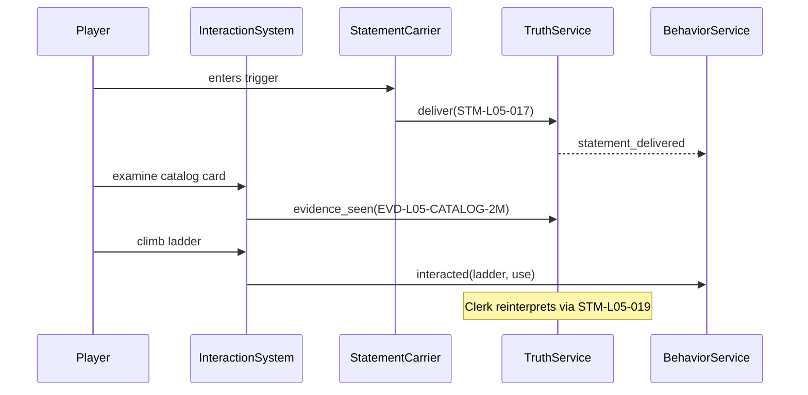

# CODE_ARCHITECTURE

> **Status:** DESIGNED — specification only; not yet implemented in `game/`.

## 1. Coding standards

- Typed GDScript everywhere (`var x: int`, `func f() -> void`). Project setting: warnings for untyped declarations = Error.
- `class_name` on reusable classes; one class per file; ≤ 400 lines.
- Signals declared at top, named in past tense (`statement_delivered`).
- No `get_node("../..")` chains; use `@export var` NodePaths/`%UniqueNames`.
- No game content in code: IDs and text come from data.
- Public API documented with `##` doc comments.

## 2. Key classes and responsibilities

| Class | Responsibility | Collaborators |
|---|---|---|
| `Interactable` | State, verbs, detail layers | InteractionSystem, EventBus |
| `InteractionSystem` | Focus raycast, verb dispatch | PlayerRig |
| `StatementCarrier` | Delivers a statement via a channel (intercom/slip/plaque) | DialogueService |
| `EvidenceNode` | Marks observable evidence with ID and detail layer | TruthService |
| `StatementDef` (Resource) | Schema v1 (TRUTH_LIE_SYSTEM §3) | — |
| `PuzzleDef` (Resource) | Goal, conditions, nudges, evidence | PuzzleService |
| `PuzzleController` | Runtime of a puzzle | GameState |
| `GameState` (autoload) | Flags (`FlagStore`), Change Journal, progress, RNG seeds; `apply_change(change_id)` | TruthService (notified), SaveService |
| `LevelBase` | Lifecycle, anchors, prewarm list | LevelService |
| `LevelGuard` | Repairs flags after sequence breaks | PuzzleService |
| `LedgerModel` | Evidence topology, marks | TruthService, UI |
| `PlayerProfile` / `AdaptationPlanner` | Behavior | BehaviorService |
| `MusicDirector` | Stem mixing from parameters | AudioService |
| `UIScreen` | Base screen with enter/exit/focus | UIRouter |
| `StateMachine` / `State` | Generic FSM | Player, UI |

### File locations (`res://`)

| Class | Path |
|---|---|
| `Interactable`, `InteractionSystem`, `DetailLayer`, `ItemDef` | `scripts/interaction/` |
| `StatementCarrier`, `DialogueService` | `scripts/dialogue/` |
| `TruthService`, `StatementDef`, `SourceDef`, `EvidenceDef`, `EvidenceNode`, `LedgerModel` | `scripts/truth_lie/` |
| `PuzzleService`, `PuzzleDef`, `PuzzleController` | `scripts/puzzle/` |
| `LevelService`, `LevelBase`, `LevelDef`, `LevelGuard` | `scripts/world/` |
| `EventBus`, `GameState`, `FlagStore`, `ChangeJournal`, `RngService`, `Log`, `StateMachine`/`State`, `SettingsService`, `SettingDef`, `InputService`, `DebugService` | `scripts/core/` (setting defaults: `resources/game_data/settings/`) |
| `PlayerProfile`, `AdaptationPlanner`, `BehaviorService` | `scripts/behavior/` |
| `MusicDirector`, `AudioService` | `scripts/audio/` |
| `UIScreen`, `UIRouter`, ledger UI | `scripts/ui/` |
| `SaveService`, serializer, migrations | `scripts/save/` |
| Test harness (`TestHarness`) | `game/tests/` (`res://tests/`) |

## 3. Interface sketches

### Interactable
```gdscript
class_name Interactable extends Node3D

signal examined(layer: int)
signal used(verb: StringName)
signal state_changed(key: StringName, value: Variant)

@export var id: StringName
@export var verbs: Array[StringName] = [&"examine"]
@export var detail_layers: Array[DetailLayer] = []
var state: Dictionary = {}

func can_interact(verb: StringName) -> bool: return verb in verbs
func interact(verb: StringName, actor: Node) -> void:
    assert(can_interact(verb))
    _perform(verb, actor)
    EventBus.interacted.emit(id, verb)

func _perform(_verb: StringName, _actor: Node) -> void:
    pass  # override

func export_state() -> Dictionary: return state.duplicate(true)
func import_state(d: Dictionary) -> void: state = d.duplicate(true)
```

### StatementCarrier
```gdscript
class_name StatementCarrier extends Node3D
@export var statement_id: StringName
@export var channel: StringName   # &"intercom", &"slip", &"plaque"
@export var trigger: StringName   # &"on_enter", &"on_use", &"on_flag"

func deliver() -> void:
    var variant := TruthService.get_variant(statement_id)
    DialogueService.present(statement_id, variant, channel, self)
    TruthService.deliver(statement_id, {"carrier": get_path()})
```

### TruthService (evaluation core, simplified)
```gdscript
func evaluate(id: StringName) -> Evaluation:
    var s: StatementDef = _db[id]
    var holds := true
    match s.truth_state:
        &"TRUTH", &"CONTEXTUAL", &"TECHNICAL": holds = true  # literal frame holds
        &"FALSE", &"DECEPTIVE": holds = false
        &"TEMPORAL": holds = s.conditions.all(func(c): return c.holds(GameState))
        _: holds = true
    return Evaluation.new(id, holds, s.truth_state)
```
Note: `holds` reflects the **literal claim**; the category captures *why* it may still mislead.

### Puzzle flow
```gdscript
func _on_world_changed(change_id: StringName) -> void:
    for p in _active:
        if p.def.is_solved(GameState):
            p.set_state(PuzzleController.State.SOLVED)
            GameState.apply_change(p.def.on_solved_change)
```

## 4. Event flow example (L05 puzzle)



## 5. Resource schema classes

`StatementDef`, `SourceDef`, `EvidenceDef`, `PuzzleDef`, `LevelDef`, `VariantRef`, `Condition` — all `extends Resource` with `@export` fields; validated by `res://scripts/utilities/lint/validate_data.gd` (planned).

## 6. Error handling

- Missing ID → `push_error` + fallback placeholder (debug) / silent safe default (release) + log.
- All service calls return values or `Result`-like dictionaries `{ok, error}` for IO.

## 7. Testing hooks

- Services accept injected dependencies in `_init_for_test()`.
- `TestHarness.run_level(level_id, input_script)` (in `res://tests/`) for headless playthrough of recorded inputs.
- Deterministic RNG injectable.

## 8. Acceptance criteria

- `gdlint`/`gdformat` clean in CI.
- Unit test coverage ≥ 70% for `res://scripts/truth_lie/`, `res://scripts/behavior/`, `res://scripts/save/`.
