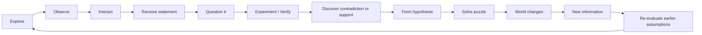

# CORE_MECHANICS

> **Status:** DESIGNED — specification only; not yet implemented in `game/`.

## 1. Core loop



**Micro-loop (30–90 s):** notice → examine → verify → act.
**Macro-loop (15–25 min):** enter wing → receive claims → resolve one central contradiction → world shift → exit.

## 2. Information sources

Every piece of information has a **Source** with a reliability profile and a voice signature (see TRUTH_LIE_SYSTEM §4).

| Source ID | Channel | Introduced | Diegetic? |
|---|---|---|---|
| `SRC_CLERK_VOICE` | Intercom speakers (+ captions) | L01 | Yes |
| `SRC_CLERK_SLIP` | Typed slips from pneumatic tube | L01 | Yes |
| `SRC_PLAQUE` | Engraved plaques / signage | L01 | Yes |
| `SRC_MARGIN` | Previous Witness handwriting | L02 | Yes |
| `SRC_CLOCKS` | Wall clocks / watch | L01 | Yes |
| `SRC_DISPATCH` | Radio operator "Dispatcher" | L08 | Yes |
| `SRC_REFLECT` | Mirrors | L09 | Yes |
| `SRC_ECHO_*` | Echo figures (testimony) | L12 | Yes |
| `SRC_PANEL` | Facility panels (indicator lamps) | L13 | Yes |
| `SRC_ASSIST` | Out-of-world help | any | **No** (always truthful) |

## 3. Interaction model

- **Focus:** center raycast (range 2.2 m) + 0.35 m sphere forgiveness. One focused `Interactable` at a time.
- **Prompt:** a small brass dot appears on focus; a verb label ("Open", "Read") fades in only after 0.6 s of continued focus or on *Examine* (no constant prompts).
- **Examine:** camera eases toward object (FOV −12°, 0.35 s); reveals up to 3 *detail layers* by repeated tap (surface → label → hidden/under detail). Each layer may expose a clue or statement.
- **Use:** instant or hold-to-operate; mechanisms report state through physical animation + sound, never through UI text.
- **Carry:** carried object follows camera with spring; drop physics enabled.

### Interactable contract

```
Interactable (Node3D / Area3D)
  id: StringName              # e.g. OBJ_L03_DOOR_C
  verbs: Array[Verb]          # EXAMINE, USE, PICKUP...
  detail_layers: Array[DetailLayer]   # each may emit statements/evidence
  state: Dictionary           # serialized via save system
  signals: focused, unfocused, examined(layer), used(verb), state_changed
```

## 4. Verification verbs ("tools of doubt")

| Tool | How the player does it | What it reveals | Typical use |
|---|---|---|---|
| **Cross-check** | Annotate two statements/evidence in Ledger | Links (supports / conflicts); *not* truth verdicts | Contradiction spotting |
| **Test** | Physically operate/probe an object | Direct world-state | "Is the door really locked?" |
| **Wait** | Hold Z in allowed volume | Temporal changes | Pump cycles, clocks |
| **Compare** | Examine two objects in sequence (ghosted memory overlay of previous examine, 1.5 s) | Differences | Spot-the-difference |
| **Listen** | Hold C | Positional and band-limited audio cues | Sound logic puzzles |
| **Ask** | Interact with intercom/bell (limited, diegetic) | Another statement (often rephrased) | Eliciting reinterpretation |

## 5. The Ledger (diegetic notebook)

- Pages are generated from *discovered* statements and evidence the player has seen.
- Player actions: **Mark** (Trust / Doubt / blank), **Link** (supports/conflicts), **Note** (short free text, 80 chars, optional).
- The Ledger **never** shows truth state. It shows **evidence topology** (what supports/contradicts what) and **provenance** (who said it, where, when).
- Stamps are cosmetic feedback: ink flourish on Link, *not* a verdict.
- Used mechanically in L11 (consistency check) and L15 (exhibits).

## 6. World-state change

World changes are triggered by **puzzle completion flags**, **timers**, or **behavior events**. All changes go through `GameState.apply_change(change_id)`, which:
1. Updates flags.
2. Emits `world_changed(change_id)`.
3. Invokes `TruthService.on_world_changed()` to re-evaluate time/state-dependent statements.
4. Logs to the **Change Journal** (used for fairness QA: every statement flip must cite a visible change).

## 7. Time model

- `local_time` per level (seconds), paused in menus/Ledger.
- `Wait` accelerates only `puzzle_time` inside volumes tagged `allows_wait`.
- Real-world time is never used for puzzle logic (avoids exploits and trust concerns).

## 8. Drift (instability) parameter

Each zone has `drift: 0..5` (WORLD_BUILDING §6). Drift is **presentation**, driven by narrative state and (lightly) by behavior; it never changes the logical solution of a puzzle unless that change is an authored, telegraphed world event.

## 9. Edge cases

| Case | Resolution |
|---|---|
| Player solves puzzle by unintended path | Allowed if no sequence break corrupts later truth; otherwise flags are repaired by `LevelGuard` |
| Player misses the only intercom statement | Statements repeat via slip on request (Ask) with equivalent content (same truth state) |
| Player leaves volume mid-Wait | Wait cancels cleanly, state keeps accumulated time |
| Save during mutating statement | Statement variant ID stored; see SAVE_SYSTEM |
| Statement becomes false *while* player reads it | Prohibited: mutation events are delayed until focus ends (0.5 s grace) |
| Carried item soft-locks (dropped in unreachable place) | Items respawn at tagged anchor after 20 s if unreachable |

## 10. Acceptance criteria

- Every puzzle can be completed using only: Examine, Use, Carry, Listen, Wait, Ledger.
- No mechanic requires reading small text without scaling options.
- Every verb has a keyboard, mouse and controller binding (INPUT_SYSTEM).
