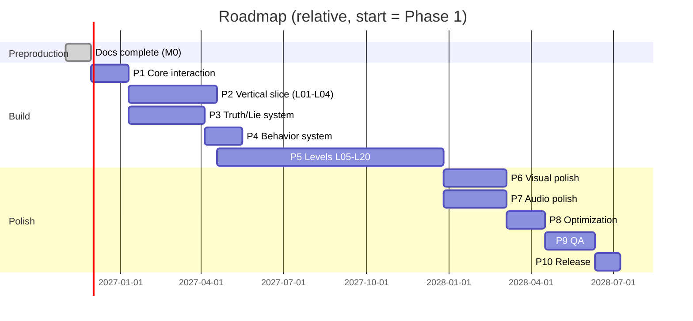

# DEVELOPMENT_ROADMAP

> **Status:** ACTIVE (planning document).

## 1. Assumptions

- Team: 1 lead dev/designer, 1 gameplay/tools dev (or agent-assisted), 1–2 environment/UI artists, 1 audio (part-time), 1 writer (part-time).
- Estimates in calendar weeks for that team. **Solo developer multiplier: ×2.0–2.5.**
- Phases overlap where noted. Total ≈ 80–95 weeks (≈ 18–22 months).

## 2. Phase overview

## 3. Phases

| Phase | Weeks | Goal | Key deliverables | Exit gate |
|---|---|---|---|---|
| **P1 Core interaction prototype** | 6 | Prove first-person feel and interaction model | Player rig, interaction ray, examine/use/carry, Ledger stub, one greybox room, save stub, input service, debug overlay | M1 |
| **P2 Vertical slice** | 14 | One polished slice: **L01–L04** | Final-quality art for 4 levels, statement stub with real lies, UI (menu, Folder, Ledger), audio pass v1, captions, Settings v1, Accessibility v1 | M2 (external playtest) |
| **P3 Truth/Lie system** | 12 (overlaps P2) | Formalize system | Full `TruthService`, evidence graph, mutations, reinterpretation, lint tool, CSV pipeline, Change Journal, full save integration | M3 |
| **P4 Behavior system** | 6 | Adaptive layer | Profile, EMA, planner, adaptations catalog, Fixed/Adaptive modes, L10 prototype, data view in Settings | M4 |
| **P5 Additional levels** | 36 | L05–L20 playable | Greybox → blockout → puzzle-complete → art-complete in waves of 4 | M5 (content complete) |
| **P6 Visual polish** | 10 | Cohesion and anomaly polish | Lighting passes, Drift VFX, UI transitions, colour grading, Reduced Motion variants | M6a |
| **P7 Audio polish** | 10 | Final mix and VO | VO recording, music, dynamic system, mix, captions verification | M6b |
| **P8 Optimization** | 6 | Meet budgets | Perf passes per level, stutter fixes, presets | M7 |
| **P9 QA** | 8 | Stability and fairness | Test cycles, fairness playtests, accessibility tests, bug burn-down | M8 (RC) |
| **P10 Release** | 4 | Ship | Store pages, build signing, release checklist, day-one patch plan | M9 |

## 4. Level production waves (P5)

| Wave | Levels | Weeks | Notes |
|---|---|---|---|
| A | L05–L08 | 9 | Records/mechanical families |
| B | L09–L12 | 9 | Mirror, behavior mirror, testimony |
| C | L13–L16 | 9 | Panels, audio loops, hearing, reel |
| D | L17–L20 | 9 | Exit, vault, reveal, verdict + endings |

Each level pipeline: **Spec → Greybox (1 wk) → Puzzle-complete (1 wk) → Playtest → Art (2–3 wks) → Audio (1 wk) → Perf (0.5 wk)**, overlapped across levels.

## 5. Critical path

P1 → P2 (L01–L04) ↔ P3 → P5 (puzzle-complete content needs the Truth system) → P6/P7 → P9.
Risk-first: build L03 (audio mismatch) and L09 (reflection) technical spikes in P1/P2.

## 6. Technical spikes (done in P1, 1 week each, may run in parallel)

| Spike | Question | Success |
|---|---|---|
| S1 Lightmap + 60 FPS | Can baked GI room hit budget on reference rig? | ≥ 60 FPS |
| S2 Planar/SSR reflections for L09 | Can reflections show different state cheaply? | ≤ 1.5 ms |
| S3 SubViewport Ledger | Diegetic 2D UI on 3D quad readable at 1080p | Legible |
| S4 Footstep reverb per zone | Dead-spot detection feasible | Tunable |
| S5 Stitched impossible space | Portal/teleport trick stable | No visible pop |

## 7. Risks and contingencies

| Risk | Trigger | Contingency |
|---|---|---|
| Art throughput | Wave A slips > 3 wks | Cut to 18 levels (README §9) |
| Truth system complexity | Lint false positives | Simplify categories internally; keep schema |
| Godot version change | Breaking changes | Stay on Godot 4.7.x (patch releases only); a minor upgrade needs a DESIGN_DECISIONS entry and happens at a milestone boundary |
| Voice recording delay | Actor unavailable | Temp VO + captions; recording window before M8 |

## 8. Acceptance criteria

- Each phase has an owner, a start/end date and an exit gate in MILESTONES.md.
- Roadmap reviewed at each milestone; slips > 2 weeks trigger scope review.
