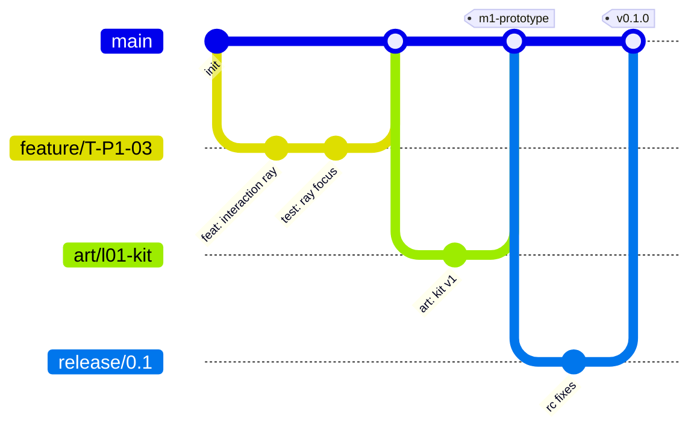

# GIT_WORKFLOW

> **Status:** ACTIVE — governs the repository as it is now.

## 1. Model

Trunk-based with short-lived branches. `main` is always buildable and passes CI.

## 2. Branches

| Branch | Purpose | Lifetime |
|---|---|---|
| `main` | Integrated, buildable | Permanent |
| `feature/<task>` | Code/design work | ≤ 5 days |
| `art/<name>`, `audio/<name>` | Content work | ≤ 7 days |
| `fix/<issue>` | Bug fixes | ≤ 2 days |
| `release/x.y` | Stabilization from M8 | Until release |
| `proposal/<name>` | Design proposals (docs only) | Until decision |

## 3. Commits

Conventional Commits: `type(scope): summary [Task-ID]`.
Types: `feat, fix, art, audio, docs, refactor, perf, test, build, chore`.
Scopes: `truth, behavior, ui, level, puzzle, save, input, settings, audio, vfx, build`.

## 4. Pull requests

Required: linked task ID, description, screenshots/video for visual changes, test evidence, and checklist:

- [ ] CI green (unit, lint, validate names/assets)
- [ ] Perf impact noted (scene budgets)
- [ ] Docs updated (if behavior/architecture changed)
- [ ] License ledger updated (if assets added)
- [ ] Saves compatible (migration added if schema changed)

Reviews: 1 approval (2 for `game/scripts/core/`, `game/scripts/truth_lie/`, `game/scripts/save/`). Squash merge.

## 5. Large files and merge safety

- **Git LFS** for: `.blend .kra .psd .png .jpg .tga .wav .ogg .mp3 .glb .fbx .exr .hdr .mp4 .ttf .otf .sbsar`.
- Godot text formats (`.tscn`, `.tres`, `.gd`) are text → merge-friendly; avoid concurrent edits to the same `.tscn` (assign level ownership).
- Binary locks: use `git lfs lock` for binary files being edited (e.g. `.psd`/`.blend` if source art is versioned in an optional `art_source/` folder, DD-010).
- Do not commit `.godot/` cache, builds, or `user://` data.

### `.gitignore` and `.gitattributes`

The repository's `.gitignore` and `.gitattributes` are authoritative (not duplicated here). Summary: `.godot/`, `.env*` (except `.env.example`), `build/`, `builds/*` (except `.gitkeep`), logs/temp files and editor folders are ignored; text files are normalized to LF; binary assets (images, models, audio, fonts, video) go through Git LFS. Run `git lfs install` **before** the first commit that adds binary assets.

## 6. Versioning and tags

SemVer: `0.x.y` through Beta; `1.0.0` at release. Milestone tags `m1-…m9-…`. Release tag triggers CI export.

## 7. CI (GitHub Actions)

| Job | Status | Trigger | Steps |
|---|---|---|---|
| `import-check` | **Implemented** (`.github/workflows/godot.yml`) | push to `main`, PR | Godot 4.7.2 headless import of `game/` |
| `tests` | Planned (needs a test framework in `game/addons/`) | PR | Headless in-engine tests (`res://tests/`) |
| `truth-lint` | Planned (T-P3-06) | PR | `res://scripts/utilities/lint/truth_lint.gd` |
| `export-windows` | Planned (needs `game/export_presets.cfg`) | tag | Headless export, artifact upload |

## 8. Agent (Antigravity) rules

- One task ID per branch; small PRs (< 600 changed lines excluding data).
- Never edit docs marked "frozen" (TRUTH schema v1, IDs) without a `proposal/` PR.
- Must run tests/lint locally (or via CI) before requesting review.

## 9. Acceptance criteria

- Fresh clone + `git lfs pull` + open in Godot = runs in < 10 min.
- `main` never red for > 1 hour.
