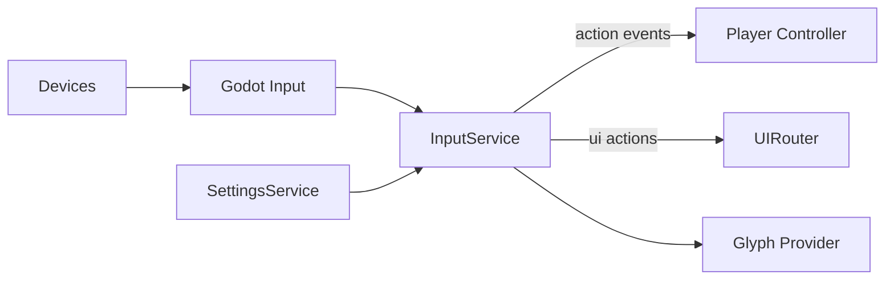

# INPUT_SYSTEM

> **Status:** DESIGNED — specification only; not yet implemented in `game/`.

All gameplay reads **actions**, never raw keys. Controller support is designed in from day one.

## 1. Action map

| Action | Keyboard / Mouse | Gamepad (Xbox layout) | Type |
|---|---|---|---|
| `move_forward/back/left/right` | W/S/A/D | Left stick | Axis |
| `look` | Mouse delta | Right stick | Axis |
| `interact` | E / LMB | A | Tap/Hold |
| `examine` | E (tap, on focus) / RMB | X | Tap |
| `carry_drop` | Q | B | Tap |
| `listen` | C (hold) | LT (hold) | Hold/Toggle |
| `wait` | Z (hold) | RT (hold) | Hold/Toggle |
| `ledger` | Tab | Y | Tap |
| `walk_modifier` | Left Shift (brisk) | L3 | Hold/Toggle |
| `pause` | Esc | Start | Tap |
| `ui_accept/cancel/up/down/left/right` | Enter/Esc/Arrows | A/B/D-pad | UI |
| `ui_next_tab/prev_tab` | Q/E or Ctrl+Tab | LB/RB | UI |
| `ledger_mark` / `ledger_link` | Enter / L | A / X | Ledger |

*Hold actions* support **Toggle** alternatives (Accessibility). `interact` vs `examine` on same key (E): tap = examine on non-mechanical objects, interact on mechanisms; ambiguous cases show verb label.

## 2. Architecture

`InputService` responsibilities: load bindings, apply sensitivity/deadzones, detect active device, provide glyphs, manage rebind capture, context stack (Gameplay / UI / Ledger / Locked).

## 3. Context stack

| Context | Active actions |
|---|---|
| Gameplay | move, look, interact, examine, carry, listen, wait, ledger, pause |
| Ledger | ui_*, ledger_mark, ledger_link, ledger (close), pause |
| UI | ui_* |
| Locked (scripted) | pause only (and look within constraints) |
| Rebind capture | all (raw) with 5 s timeout |

## 4. Settings

| Setting | Range | Default |
|---|---|---|
| Mouse sensitivity | 0.1–3.0 | 1.0 |
| Invert Y | bool | off |
| Gamepad look sensitivity | 0.3–3.0 | 1.0 |
| Stick deadzone | 0.05–0.4 | 0.15 |
| Look acceleration | off/low/high | low |
| Hold → Toggle (listen, wait, walk_modifier, interact-hold) | per action | Hold |
| Vibration | 0–100% | 50% |
| Gamepad glyphs | auto/Xbox/PS/Switch/Generic | auto |

## 5. Rebinding

- Per action, up to 2 bindings per device family. Conflict detection with swap/cancel.
- Reserved: `pause` cannot be unbound; `ui_cancel` mirrored to `pause` in UI context.
- Persist as `[input]` section in `settings.cfg`.
- Reset to defaults per action and global.

## 6. Hotplug and focus

- Device change detected on any input; glyphs update within 100 ms.
- Controller disconnect → pause + "Notice of Difficulty" slip.
- Window focus loss → pause (option to disable).
- Mouse captured in gameplay; released in UI/Ledger (Ledger supports mouse hover + click).

## 7. Haptics

Light pulse on interact, double pulse on wrong attempt, none for ambient. Controlled by Vibration setting and Reduced Motion (haptics unaffected unless user lowers).

## 8. Acceptance criteria

- Every action reachable on KB/M and gamepad.
- No gameplay logic reads `Input.is_key_pressed`.
- Input latency (event → camera update) ≤ 2 frames.
