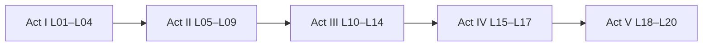

# LEVEL_DESIGN

> **Status:** DESIGNED — specification only; not yet implemented in `game/`.

20 levels, 5 acts. Target 15–25 min each. Each level introduces or evolves **one** idea.

## 1. Deception ladder (introduction order)

| Level | New deception type introduced |
|---|---|
| L01 | None (trust established) |
| L02 | Omission / implied claim |
| L03 | Sound–vision mismatch; "truth when lie expected" |
| L04 | Conflicting sources |
| L05 | Technically true |
| L06 | Contextual (frame) + visual landmarks |
| L07 | Temporally true |
| L08 | Frame mismatch (apparent lie = misunderstanding) |
| L09 | Honest-looking-wrong (reflection) |
| L10 | Behavior mirror (self-knowledge) |
| L11 | Consistency auditing |
| L12 | Unreliable characters |
| L13 | In-world UI deception |
| L14 | Audio-only reasoning |
| L15 | Cross-examination |
| L16 | Reconstruction |
| L17 | False resolution |
| L18 | Physical truth recovery |
| L19 | Source revelation |
| L20 | Evaluating the title |

## 2. Flow

## 3. Level specs

### L01 — Intake Hall (Purpose: trust & verbs)
| Field | Spec |
|---|---|
| Environment | Double-height hall, travertine, brass bell, ticket machine, 3 banker lamps, wall clock. D0. |
| Objective | Light the three lamps "from the door inward", take a number. |
| Puzzle | Lamp order reveals a dust-current pattern pointing at the ticket machine. Teaches Examine, Use, Carry, Ledger. |
| Player expectation | "The voice is a tutorial." |
| Intended deception | **None.** Every statement is true. |
| Hidden truth | Ticket number is **4471**; plaque states the 1962 slogan. |
| Env. storytelling | Worn floor path to Clerk's Window; stamp pad with SERVED lid. |
| Audio | Warm room tone, Clerk voice close, bell resonance. |
| Visual changes | At end, wall clock hand steps backwards once. |
| Behavior opportunities | Compliance (order of lamps), Thoroughness (plaque reading). |
| Ending condition | Ticket taken; Clerk Window shutter opens. |
| Transition | Door to Waiting Room unlocks with a bell chime. |

### L02 — Waiting Room (Purpose: first omission)
| Field | Spec |
|---|---|
| Environment | 18 chairs, noticeboard, two doors (left/right). D1. |
| Objective | "Please wait until your number is called. The door on the left is open." |
| Puzzle | Noticeboard reads "Numbers are not called in this room." Both doors are open. Waiting is never required. |
| Expectation | "I must wait." |
| Intended deception | Implied claim: waiting advances progress. The left door being open is true but incomplete. |
| Hidden truth | The Clerk never claimed the right door was locked. |
| Storytelling | Cups with different ages of stain; chair worn on one end. |
| Audio | Distant typing, clock ticks (slightly off-beat). |
| Visual changes | One chair differs on revisit. |
| Behavior | Patience (time waited), Compliance. |
| Ending | Pass through either door. |
| Transition | Corridor lights come on in sequence. |
| Note | At 2:30 of waiting, the Clerk says "Perhaps you have waited long enough." (true; cap). |

### L03 — Corridor of Doors
| Field | Spec |
|---|---|
| Environment | Six doors A–F, frosted-glass end wall, hanging streamers. D1. |
| Objective | "Door C leads to the Annex." |
| Puzzle | Doors unlock when six wall lamps match the floor-tile pattern seen from the doorway. A door sound occurs behind the player: the *real* far-side door beyond frosted glass opening. |
| Expectation | "Clerk lies; try another." |
| Intended deception | Player-expected lie; **the statement is true**. Sound seems wrong but is real. |
| Hidden truth | Streamers drift toward the true onward door. |
| Storytelling | Door D scratched with tally marks. |
| Audio | Positional door sound from frosted end. |
| Visual changes | Door F is slightly smaller each look-away. |
| Behavior | Skepticism (tries other doors), Experimentation. |
| Ending | Enter Door C. |
| Transition | Door closes with muted bell. |

### L04 — Coat Check
| Field | Spec |
|---|---|
| Environment | 40 numbered coat hooks, chalk ledger, UV lamp. |
| Objective | Clerk: "Take the coat you came in with." Marginalia: "Don't trust the Clerk. Take coat 12." |
| Puzzle | Player's visible sleeve cuff (grey herringbone) matches only one coat. Coat 12 is a decoy with a different cuff and a locked pocket (recoverable dead end). |
| Expectation | Choose between two sources. |
| Intended deception | Marginalia is wrong; Clerk is right. |
| Hidden truth | The coat has the 4471 tag in pocket. |
| Storytelling | Chalk ledger times don't add up. |
| Audio | Fabric sound, hangers. |
| Visual changes | Hooks count changes 40→39 after revisit. |
| Behavior | Trust patterns. |
| Ending | Wear coat; pocket contains first Notice envelope (name: **Adeyemi**). |
| Transition | Coat Check lift door. |

### L05 — Records Annex
| Field | Spec |
|---|---|
| Environment | Rolling stacks, card catalog, ladders, mezzanine 2M. |
| Objective | Find record card **R-2209**. |
| Puzzle | Clerk: "There are no files on the second floor." Cards read "2/M". Files are on mezzanine. |
| Expectation | Search floor 2. |
| Deception | **Technically true.** |
| Hidden truth | Catalog uses "2/M". Clerk later: "I said floor, not mezzanine." |
| Storytelling | Ladder wear marks lead to mezzanine. |
| Audio | Roller creaks, paper. |
| Visual | Shelf labels shift subtly (D2). |
| Behavior | Thoroughness. |
| Ending | Retrieve R-2209. |
| Transition | Stairwell door. |

### L06 — Stairwell
| Field | Spec |
|---|---|
| Environment | Concrete stairwell loop, tally marks on newel post, wall paint. D4. |
| Objective | "The fourth floor is above you." |
| Puzzle | Each ascent changes one landmark (paint coat, lamp, tally). The fourth ascent's plate reads "4". |
| Expectation | Stairs lie. |
| Deception | **Contextual**: "floor" counts climbs. |
| Hidden truth | Tally marks show three old strokes. |
| Audio | Footstep reverb shifts per loop. |
| Visual | Paint darkens each pass. |
| Behavior | Persistence. |
| Ending | Pass plate "4". |
| Transition | Door to Atrium. |

### L07 — Atrium Garden
| Field | Spec |
|---|---|
| Environment | Glass atrium, fountain, pump pipes. |
| Objective | Retrieve brass key from fountain bed. |
| Puzzle | Clerk: "The water is safe to touch." True now; becomes false when pump cycles (pipe knock, steam hiss). |
| Deception | **Temporally true.** |
| Hidden truth | Same sentence later false; timing predictable (~3 min). |
| Audio | Pipe knock warns 8 s earlier. |
| Visual | Water steam. |
| Behavior | Observation, Patience. |
| Ending | Retrieve key. |
| Transition | Atrium door. |

### L08 — Switchboard
| Field | Spec |
|---|---|
| Environment | Switchboard with 10 jacks; radio; two sources. |
| Objective | Connect call. |
| Puzzle | Clerk: "line 3 into jack 7". Dispatcher: "line 3 into jack 2". Front-side and operator-side numbering mirror (n ↔ 9−n). |
| Deception | **Frame mismatch.** Both true. |
| Hidden truth | Rear panel stamped "OPERATOR SIDE". |
| Audio | Radio crackle changes with side. |
| Visual | Lamp response. |
| Behavior | Skepticism vs compliance. |
| Ending | Call connects. |
| Transition | Gallery door. |

### L09 — Mirror Gallery
| Field | Spec |
|---|---|
| Environment | Mirrors reveal cracks invisible in the room. |
| Objective | Cross floor safely. |
| Puzzle | Mirrors show which tiles are cracked. Clerk: "The mirrors cannot be trusted." (**deceptive**). |
| Deception | Honest-looking-wrong. |
| Hidden truth | Mirrors are truthful. |
| Audio | Cracks sound as faint tick. |
| Visual | Reflection shows door open. |
| Behavior | Trust vs doubt. |
| Ending | Reach door. |
| Transition | Admin lift. |

### L10 — Observation Gallery
| Field | Spec |
|---|---|
| Environment | Diorama of the Concord; four display cases. |
| Objective | Choose the false habit. |
| Puzzle | Cases state habits from your behavior; one is false (an inverted high-confidence trait). |
| Deception | Behavior mirror; verify by self-recall. |
| Hidden truth | Statements generated only from confidence ≥ 0.7 traits. |
| Audio | Soft tick on each trait. |
| Visual | Figure tracks diorama path. |
| Behavior | **Primary**. |
| Ending | Select false case. |
| Transition | Door to Ledger Room. |
| Fixed Experience | Uses canned archetype statements. |

### L11 — Ledger Room (Archive of Small Lies)
| Field | Spec |
|---|---|
| Environment | Filing wall with 12 cards from earlier levels. |
| Objective | File each under evidence-consistent shelf. |
| Puzzle | Door opens when every card is linked to ≥ 1 supporting/contradicting evidence consistently. |
| Deception | Self-audit. |
| Hidden truth | Two cards cannot be consistently filed (intentional); these hint at reinterpretation. |
| Audio | Card shuffles. |
| Visual | Cards glow when linked. |
| Behavior | Thoroughness. |
| Ending | Door opens. |
| Transition | Refectory. |

### L12 — Refectory
| Field | Spec |
|---|---|
| Environment | Long dining table, three Echoes, place-cards, clock. |
| Objective | Reconstruct timeline of the fire day. |
| Puzzle | Pell lies (self-protection), Haddad mistaken on times, Courier omits shortcut. Physical evidence (wax stamp, dinner plates with time marks) resolves. |
| Deception | Unreliable characters. |
| Hidden truth | Notice 4471 was never delivered. |
| Audio | Echoes' voices slightly out of sync. |
| Visual | Echoes shimmer. |
| Behavior | Questioning style. |
| Ending | Place correct order. |
| Transition | Service stairs. |

### L13 — Maintenance Level
| Field | Spec |
|---|---|
| Environment | Breaker panel, transformer hum, indicator lamps. |
| Objective | Restore power. |
| Puzzle | Indicator lamps lag one step; transformer hum pitch tells true state. |
| Deception | In-world UI lies (props only). |
| Hidden truth | Lag consistent. |
| Audio | **Primary**: pitch. |
| Visual | Lamp lag. |
| Behavior | Listening usage. |
| Ending | Power on. |
| Transition | Lift. |
| Rule | Real HUD/menus never lie (R9). |

### L14 — Long Hallway
| Field | Spec |
|---|---|
| Environment | Endless corridor loop. |
| Objective | Find the exit. |
| Puzzle | Exit is where footstep echo does not return (dead spot). Clerk: "You have gone the wrong way." |
| Deception | Audio-only reasoning. |
| Hidden truth | Clerk's statement repeats irrespective of position. |
| Audio | Footstep reverb system. |
| Visual | None (visual loop). |
| Behavior | Persistence. |
| Ending | Find dead spot. |
| Transition | Hearing Room. |

### L15 — Hearing Room
| Field | Spec |
|---|---|
| Environment | Bench, lectern, evidence trays. |
| Objective | Contradict three entries in the Record of Proceedings. |
| Puzzle | Choose exhibits from Ledger. Wrong exhibit is rebutted truthfully. |
| Deception | Cross-examination. |
| Hidden truth | Two entries concede; 4471 deferred. |
| Audio | Gavel. |
| Visual | Oxblood lighting. |
| Behavior | Exhibit choices. |
| Ending | Proceeding adjourns. |
| Transition | Projection Room. |

### L16 — Projection Room
| Field | Spec |
|---|---|
| Environment | Projector, film reel. |
| Objective | Reorder frames. |
| Puzzle | Frames ordered by shadow angle, clock, weather. |
| Deception | Reconstruction. |
| Hidden truth | The film shows the notice undelivered. |
| Audio | Projector. |
| Visual | Film grain. |
| Behavior | Observation. |
| Ending | Film completes; Clerk says "You are free to go." |
| Transition | Exit corridor. |

### L17 — The Exit
| Field | Spec |
|---|---|
| Environment | Exterior at dawn; road loops to rear door. |
| Objective | Walk away. |
| Puzzle | Player follows road; fake credits begin (skip after 3 s). |
| Deception | **False resolution.** |
| Hidden truth | Clerk: "This is not the end." (true). |
| Audio | Wind; sparse score. |
| Visual | Painted sky edge. |
| Behavior | Whether player skips credits. |
| Ending | Rear door. |
| Transition | Descent to Vault. |

### L18 — Vault
| Field | Spec |
|---|---|
| Environment | Concrete, original book, single lamp. |
| Objective | Recover the original entry. |
| Puzzle | Two inks; UV lamp reveals original text; align transparencies. |
| Deception | Physical truth recovery. |
| Hidden truth | Pell's memo (conditional truth). |
| Audio | Sparse. |
| Visual | UV. |
| Behavior | Care. |
| Ending | Entry restored visually. |
| Transition | Reading Room. |

### L19 — Reading Room
| Field | Spec |
|---|---|
| Environment | Table, dictaphone, reflection in window. |
| Objective | Listen to the recording. |
| Puzzle | Place Notices (optional) on the table; dictaphone replays the Witness's voice. |
| Deception | Source revelation. |
| Hidden truth | The Clerk is your voice. "Your File" appears. |
| Audio | **Primary**: voice. |
| Visual | Dossier. |
| Behavior | Displayed. |
| Ending | Tape ends. |
| Transition | Verdict Hall. |

### L20 — Verdict Hall
| Field | Spec |
|---|---|
| Environment | Large hall, three lecterns (Amend/Affirm/Expunge); optional fourth appears. |
| Objective | Decide. |
| Puzzle | Evaluate the title as statement: the final choice resolves `STM-TITLE-001`. |
| Deception | Title evaluation. |
| Hidden truth | See STORY_BIBLE. |
| Audio | Sparse. |
| Visual | D5 on Affirm/Expunge. |
| Behavior | Summarized. |
| Ending | Epilogue. |
| Transition | Credits. |

## 4. Level production template

Every level gets: a scene folder `res://scenes/rooms/lNN_<name>/` (`level.tscn`, room sub-scenes, greybox in Phase 2+); a data resource `res://resources/rooms/lNN_<name>/level_data.tres` (statements, puzzles, flags); a working document `docs/levels/lNN_<name>.md` (puzzle specs with **deduction chains** per PUZZLE_DESIGN §3, art review sheet); and a test plan `tests/gameplay/lNN_<name>.md`.

## 5. Acceptance criteria

- No level exceeds 40% non-true critical statements.
- Every level has ≥ 2 independent verification paths for its main deception.
- Every level has a defined "stuck" nudge.

## 6. Environment composition (v1.1)

Every level must satisfy the room template (focal point, 2–3 secondary points, landmark, interactive cluster, ≥ 2 sound sources, lighting hierarchy, three traces). The per-level table is in **UI_UX_REVIEW §7**. Reveal moments and camera staging are in **CINEMATIC_DIRECTION §9**. Level art reviews use **VISUAL_POLISH_CHECKLIST** sections D–F.
