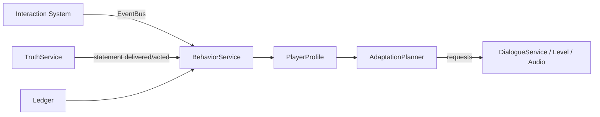

# PLAYER_BEHAVIOR_SYSTEM

> **Status:** DESIGNED — specification only; not yet implemented in `game/`.

Narrative justification: the Concord is compiling **your File**. The system is hidden until L10 and revealed in L19.

## 1. Principles

1. Subtle, bounded, optional.
2. Never punish; never make a puzzle unsolvable or unfair.
3. Local only. No telemetry, no network, no OS data.
4. Deterministic: same save + same events → same adaptations.
5. The player should feel *"it knows how I play"*, not *"it is showing me stats."*

## 2. Signals tracked

| Signal | Event | Window | Feeds |
|---|---|---|---|
| Instruction follow-through | Action matching an INSTRUCTION within 20 s | Per statement | Compliance |
| Verification before acting | Cross-check/Test/Wait before acting on a claim | Per statement | Skepticism |
| Examine coverage | % of interactables examined in a room | Per room | Thoroughness |
| Dwell before action | Time from statement to first action | Per statement | Impulsivity (inverse) |
| Revisits | Returns to same object/room | Per level | Attachment |
| Idle / wait tolerance | Time idle in waiting scenarios | Per scenario | Patience |
| Failed attempts | Wrong puzzle attempts | Per puzzle | Experimentation |
| Ledger usage | Marks/links/notes | Per level | Thoroughness, Skepticism |
| Hesitation | Pauses > 4 s at decision points | Per level | Impulsivity (inverse) |
| Hint use | Nudges/assist | Per puzzle | Stall profile |

## 3. Disposition vector

Six traits, each 0–1 with a confidence value:

| Trait | Meaning |
|---|---|
| `compliance` | Follows the Clerk's instructions |
| `skepticism` | Tests before trusting |
| `thoroughness` | Examines widely |
| `impulsivity` | Acts quickly without checking |
| `attachment` | Returns to the same places |
| `patience` | Tolerates waiting |

**Update rule (exponential moving average):** `v ← v + α·(x − v)`, α = 0.15 per event; `confidence = min(1, n / N_min)` with `N_min = 12` samples.

**Use only if `confidence ≥ 0.7`.** Dead zone: values 0.4–0.6 are treated as neutral.

## 4. Adaptation catalog

| Adaptation | Trigger | Effect | Clamp |
|---|---|---|---|
| Clerk tone variant | Compliance high / low | Warmer vs. clipped phrasing (same truth state) | Surface text only |
| Tell reliability shift | Skepticism high | Clerk tells ±10 points (stays ≤ 80%) | Lint-checked bounds |
| Nudge delays | Stall history | 4/8/12 → 3/6/9 or 6/12/18 min | ±50% |
| Reference lines | Thoroughness | Clerk comments on a *true* observed habit | ≤ 1 per 5 min, ≤ 3 per level |
| Ambient flavor | Attachment | A revisited object shows subtle wear | Visual only |
| Prop placement (flavor) | Impulsivity | Extra readable detail placed near decision points | No puzzle change |
| L10 content | Any high-confidence trait | Habit statements for display cases | Fixed Experience → canned |

**Forbidden adaptations:** changing puzzle logic or solution, hiding critical evidence, reducing evidence redundancy below spec, altering difficulty unfairly, triggering anything on real-time/clock/system data.

## 5. Gating and cooldowns

- Adaptation starts after **L04** (enough data).
- Global cooldown: one *visible* adaptation per 5 minutes; ≤ 3 per level.
- Each adaptation is logged with the event that triggered it (QA, replay).

## 6. Experience modes

| Mode | Behavior |
|---|---|
| **Adaptive Experience** (default) | Full system |
| **Fixed Experience** | Tracking still computed for the credits "File" only if enabled; adaptations use authored defaults. Option to *disable tracking entirely* (File shows generic content) |

Toggle in Settings → Gameplay; changing mid-game is allowed and takes effect at next level.

## 7. Data model

```gdscript
class_name PlayerProfile extends Resource
@export var traits: Dictionary = {}          # name -> {value, confidence, n}
@export var counters: Dictionary = {}        # e.g. doors_opened, drawers_opened
@export var adaptation_log: Array[Dictionary] = []
@export var tracking_enabled: bool = true
```

Counters feed the L19 "Your File" dossier (e.g., "You examined 212 objects"). Only **in-game** counters are shown.

## 8. Event pipeline



`AdaptationPlanner` returns **proposals**; owning systems accept only if allowed by level metadata (`adaptation_whitelist`).

## 9. Privacy and ethics

- Stored only inside the player's save under `user://`.
- Visible in a "Data" section in Settings with a **Reset Profile** button.
- Never uses real clock, hardware, locale, or filesystem info.

## 10. Edge cases

| Case | Handling |
|---|---|
| Streamer / speedrunner | Fixed Experience recommended; no random adaptation |
| Player plays erratically | Confidence stays low → no adaptation |
| Save loaded after profile reset | Profile restarts; L10 uses canned statements |
| Co-op or shared account (same save) | Not supported; profile drifts naturally |

## 11. Acceptance criteria

- Replaying the same recorded input stream produces identical adaptations (determinism test).
- No adaptation changes any lint rule outcome.
- ≥ 60% of playtesters notice at least one adaptation without being told; ≤ 10% describe it as "a stats screen".
