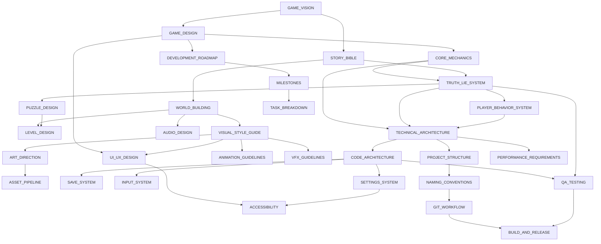

# EVERYTHING IS A LIE — Pre-Production Documentation Set

> Authoritative design and technical specification for a first-person psychological puzzle game in **Godot 4.7.2 / GDScript**, Windows PC, 1080p/60. Written to be consumed by a human team *and* by an implementation agent (Antigravity).

> **Repository note:** this folder is `docs/` in the repository. `CHANGELOG.md`, `ASSETS_LICENSES.csv` and the root `README.md` are at the repository root. The Godot project is `game/`, so **`res://` = `game/`** (PROJECT_STRUCTURE §1). Decisions that resolved conflicts between documents: DESIGN_DECISIONS.md. Each document starts with a status line: **DESIGNED** (specification only), **PLANNED** (tooling not built yet) or **ACTIVE**; nothing in `game/` is implemented beyond the starter `project.godot`.

**Status:** Pre-production v1.0 · **Do not implement from this file alone** — read the documents in the order below.

---

## 1. One-paragraph pitch

You are a *Witness* admitted to **the Concord**, a vast mid-century Hall of Records. A courteous house voice — **the Clerk** — guides you with statements, slips, plaques and instructions. Some are true. Some are false, incomplete, technically true, true only for a while, or true in a frame you haven't noticed. The building also watches how you play and files it. You escape by learning the building's *language of doubt*, not by inverting what you're told. The deepest question: which statement was the first lie — and who told it?

## 2. Design pillars (quick reference)

| # | Pillar | One-line test |
|---|--------|---------------|
| 1 | **Fair deception** | After every reveal the player can name the evidence they *could* have used. |
| 2 | **The world speaks** | Objectives arrive through space, light, sound and objects — not a quest HUD. |
| 3 | **Doubt is a skill** | Verification actions (cross-check, wait, compare, listen) are first-class verbs. |
| 4 | **The building knows you** | Adaptation is real, bounded, and narratively justified ("your File"). |
| 5 | **Quiet dread** | Tension from uncertainty and impossible-but-subtle geometry, not jump scares. |

## 3. Document map

Legend — **M** = mandatory before Phase 1 begins · **VS** = mandatory before Vertical Slice (Phase 2) · **L** = may be completed later (needed by phase shown).

| Document | Purpose | Priority |
|---|---|---|
| README.md | This index and project-wide decisions | M |
| GAME_VISION.md | Vision, pillars, audience, scope | M |
| GAME_DESIGN.md | Structure, verbs, pacing, difficulty, hints | M |
| CORE_MECHANICS.md | Loop, interaction, verification, Ledger | M |
| STORY_BIBLE.md | Hidden truth, characters, endings | VS |
| WORLD_BUILDING.md | The Concord, rules, Drift model | VS |
| LEVEL_DESIGN.md | All 20 levels, deception ladder | M (L01–L04), L (rest by P5) |
| PUZZLE_DESIGN.md | Taxonomy, spec template, flagship puzzles | VS |
| TRUTH_LIE_SYSTEM.md | Statement model, categories, fair-play rules | M |
| PLAYER_BEHAVIOR_SYSTEM.md | Hidden profile, adaptation, privacy | L (P4) |
| UI_UX_DESIGN.md | Screens, flows, diegetic classification | VS |
| VISUAL_STYLE_GUIDE.md | Palette, type, lighting, UI language | VS |
| ART_DIRECTION.md | Asset categories, sourcing, budgets | VS |
| ANIMATION_GUIDELINES.md | Timings, easing, camera | L (P6) |
| VFX_GUIDELINES.md | Particles, anomalies, post-processing | L (P6) |
| AUDIO_DESIGN.md | Buses, contradictions, music, captions | VS |
| TECHNICAL_ARCHITECTURE.md | Layers, autoloads, data flow | M |
| PROJECT_STRUCTURE.md | Directory layout | M |
| CODE_ARCHITECTURE.md | Classes, interfaces, pseudocode | M |
| SAVE_SYSTEM.md | Save model, schema, integrity | M (stub) / L (full P3) |
| INPUT_SYSTEM.md | Actions, rebinding, controller | M |
| SETTINGS_SYSTEM.md | Settings schema and defaults | L (P2) |
| ACCESSIBILITY.md | Requirements and parity rules | VS |
| PERFORMANCE_REQUIREMENTS.md | Budgets and targets | M |
| QA_TESTING.md | Strategy, matrix, fairness metrics | L (full by P9; plan by P2) |
| ASSET_PIPELINE.md | DCC → Godot, formats, licensing | VS |
| NAMING_CONVENTIONS.md | Files, IDs, code | M |
| GIT_WORKFLOW.md | Branching, LFS, commits | M |
| DEVELOPMENT_ROADMAP.md | Phases 1–10 | M |
| MILESTONES.md | Gates and exit criteria | M |
| TASK_BREAKDOWN.md | Epics and tasks with estimates | M (P1–P2), L (rest) |
| BUILD_AND_RELEASE.md | Export, CI, release checklist | L (P9) |
| CHANGELOG.md (repo root) | Living change record | M (living) |
| DESIGN_DECISIONS.md | Decisions that resolved document/architecture conflicts | M (living) |
| UI_UX_REVIEW.md | Art/UX review, color language, diegetic audit, composition | VS |
| UI_COMPONENT_SPEC.md | Tokens, type scale, components, screens, notifications | VS |
| CINEMATIC_DIRECTION.md | Camera rig, framing, reveals, cinematic moments | VS |
| VISUAL_POLISH_CHECKLIST.md | Scored polish gates (M1/M2/M6/M8) | VS |

### Dependency graph

## 4. Recommended development order (documents → work)

1. **Read:** GAME_VISION → GAME_DESIGN → CORE_MECHANICS → TRUTH_LIE_SYSTEM.
2. **Lock technical spine:** TECHNICAL_ARCHITECTURE → PROJECT_STRUCTURE → CODE_ARCHITECTURE → NAMING_CONVENTIONS → GIT_WORKFLOW → INPUT_SYSTEM.
3. **Start Phase 1** (core interaction prototype) using only the above plus PERFORMANCE_REQUIREMENTS.
4. **In parallel with Phase 1:** finalize STORY_BIBLE, WORLD_BUILDING, VISUAL_STYLE_GUIDE, AUDIO_DESIGN, UI_UX_DESIGN, ART_DIRECTION, LEVEL_DESIGN L01–L04.
5. **Phase 2 (vertical slice L01–L04)** adds SAVE_SYSTEM (full), SETTINGS_SYSTEM, ACCESSIBILITY, ASSET_PIPELINE.
6. **Deviation from the master prompt's phase order (deliberate):** the vertical slice already contains the first omissions and falsehoods (L02–L04). Phase 2 therefore ships a *data-driven statement stub* (`StatementDef` resources + `TruthService.evaluate()` returning a category), and Phase 3 formalizes conditions, mutation events, the Ledger evidence graph and lint tooling. The stub's public API is frozen in TRUTH_LIE_SYSTEM §10 so nothing is rewritten.

## 5. Recommended toolchain

| Area | Tool | Notes |
|---|---|---|
| Engine | **Godot 4.7.2 stable** (DESIGN_DECISIONS DD-001) | Forward+ renderer default; evaluate the Mobile renderer only if budgets fail. Only 4.7.x patch releases during development. |
| Language | GDScript (typed); C# *not* used | Native extension (GDExtension) only if profiling proves need. |
| Tests | gdUnit4 (or GUT) + custom headless lint runners | See QA_TESTING. |
| DCC | Blender (modeling, baking), Krita/Affinity (textures), Substance optional | Export glTF 2.0. |
| Audio | Reaper (or any DAW), Audacity for cleanup, Wwise/FMOD **not** used | Godot audio buses + custom dynamic layer. |
| Version control | Git + Git LFS | See GIT_WORKFLOW. |
| CI | GitHub Actions (headless export + tests) | Self-hosted runner optional. |
| Issue tracking | GitHub Projects / Linear / Notion | Mirror TASK_BREAKDOWN IDs. |
| Docs | Markdown + Mermaid in repo `/docs` | This set lives there. |
| IDE | Godot editor + VS Code (GDScript extension) | Antigravity can work on the repo directly. |

## 6. Hardware & software requirements

**Development machine (recommended)**
- CPU 8 cores (Ryzen 7 5700X / i7-12700 class), RAM 32 GB, GPU 12 GB VRAM (RTX 3060 12GB class), 1 TB NVMe, 1080p + optional second monitor, Xbox-style controller, closed-back headphones.

**Reference "mid-range" test rig (all performance claims are measured here)**
- Ryzen 5 3600, 16 GB RAM, GTX 1660 Super (6 GB), SSD, Windows 10/11 64-bit.

**Player minimum (Low preset, 1080p, render scale 75–85%, 60 FPS)**
- 4-core CPU (i5-8400 / Ryzen 5 1600), 8 GB RAM, GTX 1060 6GB / RX 580, 8 GB storage, Vulkan 1.2-capable GPU.

**Player recommended (High preset, 1080p, 60 FPS)**
- Reference rig above.

**Software:** Windows 10/11, Godot 4.7.2, Blender (LTS), Git ≥ 2.40, Git LFS, Python 3.11 (tooling scripts only), VS Code, Reaper, Krita.

## 7. Milestones (summary — see MILESTONES.md)

M0 Pre-production complete → M1 Interaction prototype → M2 Vertical slice → M3 Truth system complete → M4 Behavior system → M5 Content complete (L01–L20 greybox→playable) → M6 Visual/Audio polish → M7 Optimization → M8 Release candidate → M9 Gold.

## 8. Definition of "complete pre-production"

Pre-production is complete when **all** of these are true:

1. The 12 documents marked **M** are reviewed and signed off; no `TBD` remains in them.
2. The Truth/Lie schema is frozen (v1) and ≥ 25 sample statements pass the lint rules in TRUTH_LIE_SYSTEM §9 on paper.
3. L01–L04 have full level specs, puzzle specs with deduction chains, and a greybox plan.
4. The visual identity exists as a one-page **look-dev target** (3 mood frames + UI board) approved by the director — *not* implementation.
5. A technical spike checklist is passed: first-person controller, interaction raycast, one baked-light room at 60 FPS on the reference rig, one save/load round-trip, one diegetic UI element rendered in 3D.
6. Asset sourcing and license ledger plan exist (ASSET_PIPELINE).
7. Risks are listed with owners (§10 below), and scope cut-lines are agreed (§9).
8. Task breakdown for Phases 1–2 is estimated to ±30%.

## 9. Scope cut-lines (decide now, not in crunch)

| Cut order | Item | Impact |
|---|---|---|
| 1 | Secret ending "Corroborate" + 7 Returned Notices | Low |
| 2 | Levels L10 and L14 compress into adjacent levels (20 → 18) | Low–Med |
| 3 | Controller rebind UI (keep defaults) | Low |
| 4 | New Game+ "Second Reading" | Med |
| 5 | Voiced Clerk → text-on-slip + sparse VO | High (tone) — avoid |

## 10. Top risks

| Risk | Likelihood | Mitigation |
|---|---|---|
| Deception feels unfair | High | Fair-play rules, lint, playtest metrics (QA_TESTING §6) |
| Art scope too large for team | High | Modular kit, trim sheets, 20 levels share ~6 "rooms families" |
| Behavior system feels gimmicky | Med | Clamped adaptations, cooldowns, opt-out |
| Fourth-wall tricks cause distrust of the *software* | Med | Hard-forbidden list (GAME_DESIGN §9) |
| Godot shader-compile hitching | Med | Pre-warm materials during diegetic transitions |

## 11. Rules for the implementation agent (Antigravity)

- Implement **one task ID at a time** from TASK_BREAKDOWN; cite the ID in commits.
- Never invent mechanics not listed in CORE_MECHANICS; open a `proposal/` note instead.
- Statements, puzzle data and dialogue live in **data files**, never hard-coded in scripts.
- Every system must expose a debug overlay (F-keys, stripped from release).
- Game code must never read or write outside `res://` and `user://`, and never read OS user info (GAME_DESIGN §9).
- Respect NAMING_CONVENTIONS and the autoload list; no new autoloads without updating TECHNICAL_ARCHITECTURE.

## 12. Content notes

The story involves **institutional negligence, a fatal fire, guilt and grief**. No gore, no depicted deaths on screen. Include a content note on the title screen and in Steam/itch descriptions.

## 13. Art & UX review layer (v1.1)

Four documents added after the UI/UX and visual-quality review: **UI_UX_REVIEW**, **UI_COMPONENT_SPEC**, **CINEMATIC_DIRECTION**, **VISUAL_POLISH_CHECKLIST** (total 37 files). Key decisions: false information has no color/style (R13); deceptive UI limited to four registered instances (R14); brass = touch; no screen-space glitch effects; UI motion spike and look-dev keyframes gate production (T-P1-17/18).
