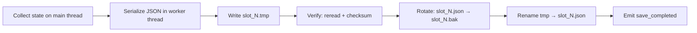

# SAVE_SYSTEM

> **Status:** DESIGNED — specification only; not yet implemented in `game/`.

## 1. Requirements

| Need | Decision |
|---|---|
| Checkpoints | Automatic at level entry and after major puzzle completion |
| Autosave | Every checkpoint + every 5 min of play (only at safe states) |
| Manual save | **Yes**, 3 slots; allowed outside scripted sequences (blocked in Locked state) |
| Player state | Position, yaw/pitch, carried item, level |
| Puzzle state | Per-puzzle state + flags |
| Discovered info | Delivered statements, evidence seen, Ledger marks/links/notes |
| Narrative state | Act, flags, endings seen, Notices collected |
| Behavior | PlayerProfile, adaptation log |
| Ending state | Endings reached (global, across slots) |

## 2. The "deception-safe" save principle

Statements that *appear to change* must not change due to loading.

1. **Delivered statements are stored by variant ID**, not recomputed (`delivered: [{id, variant_id, time}]`).
2. Temporal/mutable statements store their **mutation timeline position** (phase, elapsed).
3. Drift effects reseed from stored seeds, so anomalies do not "re-roll" on load.
4. Reinterpretation chains persist (`reinterprets`).
5. Adaptive decisions are stored (`adaptation_log`) and replayed, not re-decided.

## 3. File layout

```
user://saves/
  slot_1.json   slot_1.bak
  slot_2.json   slot_2.bak
  slot_3.json   slot_3.bak
  global.json   # endings reached, settings of NG+ unlocks
```

## 4. Schema v1 (excerpt)

```json
{
  "meta": {
    "save_version": 1,
    "game_version": "0.3.0",
    "created_utc": "2026-11-14T10:00:00Z",
    "play_time_s": 5421,
    "slot": 1,
    "checksum": "sha256:..."
  },
  "progress": {
    "act": 2, "level_id": "L05", "checkpoint_id": "CP_L05_A",
    "flags": {"L05_catalog_seen": true},
    "world_changes": ["CH_L04_COAT_TAKEN"],
    "notices_found": ["adeyemi"],
    "endings_seen": []
  },
  "player": {
    "position": [1.2, 0.0, -4.1], "yaw": 1.57, "pitch": -0.1,
    "carried": null, "level_time_s": 301.4
  },
  "interactables": {"OBJ_L05_LADDER": {"used": true}},
  "puzzles": {"PZL-L05-A": {"state": "ACTIVE", "attempts": 1}},
  "truth": {
    "delivered": [{"id": "STM-L05-017", "variant": "default", "t": 1204.5}],
    "evidence_seen": ["EVD-L05-CATALOG-2M"],
    "ledger": {"marks": {"STM-L05-017": "doubt"}, "links": [["STM-L05-017","EVD-L05-CATALOG-2M","contradicts"]], "notes": {}}
  },
  "behavior": {"traits": {"compliance": {"v": 0.62, "c": 0.8, "n": 21}}, "counters": {"objects_examined": 112}, "adaptation_log": []},
  "rng": {"drift": 12345, "ambience": 998, "adaptation": 77}
}
```

## 5. Write procedure (atomic)



- Failure at any step → keep old file, show "Notice of Difficulty" slip, log error.
- Autosave indicator = stamp glyph (1.2 s).

## 6. Load procedure

1. Read file; verify checksum; on failure try `.bak`; if both fail → error slip, offer other slots.
2. Run **migrations** `v_n → v_{n+1}` in sequence (`res://scripts/save/migrations/`).
3. `LevelService.load(level_id)` → await ready.
4. Import state in order: GameState → World/Interactables → Puzzles → Truth → Behavior → Player.
5. Apply `LevelGuard.verify()`; repair missing flags using the Change Journal.

## 7. Versioning and compatibility

- `save_version` integer; each bump requires a migration + a test with a fixture save.
- Forward compatibility: unknown fields preserved in `extra` and ignored.
- Never delete a deprecated field without migration.

## 8. Checkpoint policy

| Event | Checkpoint |
|---|---|
| Level entry | Yes |
| Puzzle solved | Yes |
| Before scripted sequences (L16–L17, L20) | Yes |
| Mid-scripted sequence | Not savable; resumes at start of sequence |
| Ending reached | Updates `global.json`; slot goes to "post-ending" |

## 9. Anti-tampering stance

Checksum is for **corruption detection**, not anti-cheat. Single-player; no obfuscation.

## 10. Edge cases

| Case | Handling |
|---|---|
| Disk full | Abort write, keep old save, error slip |
| Quit during save | Atomic rename ensures one valid file |
| Save from newer game version | Refuse with message "made by a newer version" |
| Reset Profile | Clears `behavior` only |
| Delete slot | Confirm; remove `.json` and `.bak` |

## 11. Acceptance criteria

- 1,000 randomized save/load cycles at random points produce identical subsequent behavior (determinism test).
- Kill -9 during save never leaves zero valid saves.
