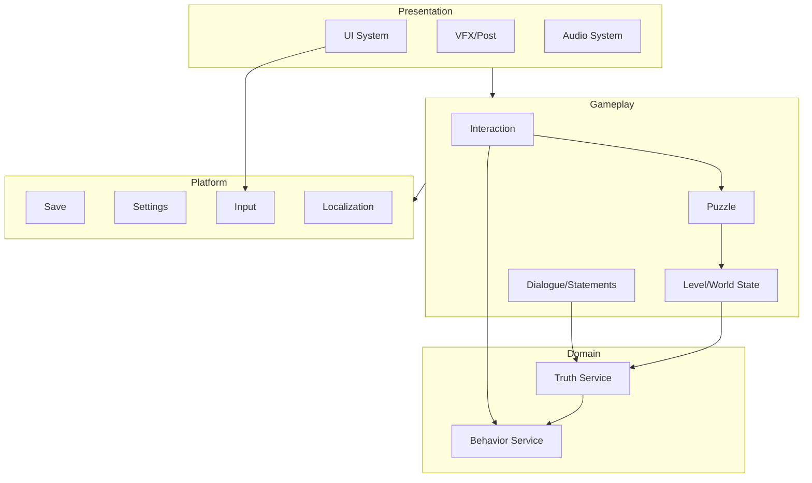
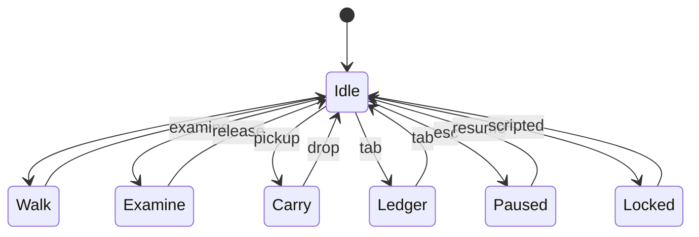

# TECHNICAL_ARCHITECTURE

> **Status:** DESIGNED — specification only; not yet implemented in `game/`.

**Engine:** Godot 4.7.2 stable (the single authoritative version; DESIGN_DECISIONS DD-001). **Language:** typed GDScript. **Renderer:** Forward+ (default). **Godot project root:** `game/` (`res://`).

## 1. Architectural principles

1. **Data-driven:** statements, puzzles, dialogue, levels are resources/data, not code.
2. **Services over singletons-with-logic:** autoloads are thin service facades with clear APIs.
3. **Signals up, calls down:** children emit; parents/services call.
4. **EventBus for cross-system events** only; no hidden dependencies.
5. **Deterministic core:** seeded RNG; same save + inputs = same outcomes.
6. **Debuggable:** every system has a debug overlay and structured logs.

## 2. Layered view



## 3. Autoloads (final list; no additions without a DESIGN_DECISIONS entry)

Thirteen autoloads, registered in `game/project.godot` **in the order below** (at `_ready` a service may only use services above it). Each autoload script stays thin (≤ 200 lines): it exposes the public API and delegates to plain classes in the same domain folder.

| # | Autoload | Script (`res://`) | Responsibility | Uses |
|---|---|---|---|---|
| 1 | `EventBus` | `scripts/core/event_bus.gd` | Typed global signals (§6) | — |
| 2 | `GameState` | `scripts/core/game_state.gd` | **Single source of truth** for flags (`FlagStore`), the Change Journal (`ChangeJournal`), act/level progress, endings and RNG seeds (`RngService`); `apply_change(change_id)` | EventBus |
| 3 | `SettingsService` | `scripts/core/settings_service.gd` | Load/apply/save settings | EventBus |
| 4 | `InputService` | `scripts/core/input_service.gd` | Action map, rebinding, device/glyphs, input context stack | SettingsService |
| 5 | `SaveService` | `scripts/save/save_service.gd` | Slots, serialization, autosave; gathers/imports state through each system's `export_state()` / `import_state()` | GameState |
| 6 | `AudioService` | `scripts/audio/audio_service.gd` | Buses, event playback, music director | SettingsService |
| 7 | `UIRouter` | `scripts/ui/ui_router.gd` | Screen stack, transitions, notifications | InputService |
| 8 | `TruthService` | `scripts/truth_lie/truth_service.gd` | Statements, evidence graph, Ledger model | GameState |
| 9 | `BehaviorService` | `scripts/behavior/behavior_service.gd` | Player profile, adaptation planner | EventBus, GameState |
| 10 | `DialogueService` | `scripts/dialogue/dialogue_service.gd` | Presents delivered statements (voice, captions, slips) | TruthService, AudioService |
| 11 | `PuzzleService` | `scripts/puzzle/puzzle_service.gd` | Puzzle registry, state, nudges | GameState, TruthService |
| 12 | `LevelService` | `scripts/world/level_service.gd` | Loads/unloads level scenes, transitions, level guard | GameState, SaveService |
| 13 | `DebugService` | `scripts/core/debug_service.gd` | Overlays, console (debug builds only) | all (read-only) |

**Not autoloads:** `Log` (static utility, `scripts/core/log.gd`), `StateMachine`, `FlagStore`, `ChangeJournal`, `RngService`, every `*Def` resource. **Localization** uses Godot's built-in `TranslationServer` (`tr()`); there is no custom localization autoload (DD-005).

## 4. Scene architecture

Main scene: `res://scenes/main/main.tscn` (planned, Phase 1).

```
main.tscn (Node)
 ├─ World            # parent for the current level instance (LevelService adds/removes it)
 ├─ PlayerRig        # instance of res://scenes/player/player_rig.tscn (CharacterBody3D + Camera3D + hands + interaction ray)
 ├─ UIRoot           # CanvasLayer stack managed by UIRouter
 ├─ AudioRoot
 └─ TransitionLayer  # instances from res://scenes/transitions/
```

Level scene template — `res://scenes/rooms/lNN_<name>/level.tscn`, root script `res://scripts/world/level_base.gd` (`LevelBase`):

```
level.tscn (Node3D)
 ├─ Geometry/        # kit + baked lights
 ├─ Interactables/   # Interactable scenes
 ├─ Carriers/        # StatementCarrier nodes: intercom, slip, plaque
 ├─ EvidenceNodes/   # EvidenceNode markers with IDs
 ├─ Volumes/         # WaitVolume, ReverbZone, DriftZone, PuzzleVolume (from res://scenes/world/)
 ├─ Anchors/         # spawn, respawn, AnchorMarker, CameraConstraint, RevealTrigger
 └─ Puzzles/         # PuzzleController children, data-driven
```

Level data — `res://resources/rooms/lNN_<name>/level_data.tres` (`LevelDef`): statements, puzzles, flags, material prewarm list, adaptation whitelist.

**Terminology:** a *level* is a numbered gameplay sequence (L01–L20) that may span 1–4 rooms; `rooms/` holds level scenes. There is no `RoomManager` (DD-003).

## 5. Core subsystems

### 5.1 Interaction
`InteractionSystem` (on PlayerRig) → raycast + sphere check → `Interactable` interface; emits `focus_changed`, `interacted`. Contracts in CORE_MECHANICS §3.

### 5.2 State machines
Player (`Idle/Walk/Examine/Carry/Ledger/Paused/Locked`), Puzzle (`Inactive/Active/Solved/Failed(rollback)`), Level (`Loading/Intro/Play/Outro/Unloading`), UI screen stack. Implemented with a lightweight `StateMachine` node + `State` resources/nodes.



### 5.3 Truth, Behavior, Dialogue
See TRUTH_LIE_SYSTEM, PLAYER_BEHAVIOR_SYSTEM. Dialogue = delivery of statements by `StatementCarrier`s; no free-form dialogue trees except L15 Hearing (graph-based).

### 5.4 Puzzle system
Data-driven `PuzzleDef` resources (conditions, evidence nodes, nudges). Controllers subclass `PuzzleController` only when logic can't be data-only.

### 5.5 Level loading
Async `ResourceLoader.load_threaded_request`; transitions masked diegetically; shader/material prewarm list per level; unload releases references.

## 6. Event bus (typed signals, partial)

All cross-system signals are declared **once, on `EventBus`**; services and nodes emit through it and never redeclare them (DD-011). Partial list: `interacted(id, verb)`, `examined(id, layer)`, `statement_delivered(id)`, `statement_reinterpreted(old_id, new_id)`, `statement_marked(id, mark)`, `evidence_linked(a, b, rel)`, `puzzle_state_changed(id, state)`, `world_changed(change_id)`, `level_entered(id)`, `level_exited(id)`, `settings_changed(key)`, `save_completed(slot)`, `behavior_adaptation_applied(id)`.

## 7. Determinism and RNG

`RngService` (a component owned by `GameState`, `res://scripts/core/rng_service.gd`) uses seeded `RandomNumberGenerator` per domain (`drift`, `ambience`, `adaptation`). Seeds persist in save. Never use global `randf()`.

## 8. Threading

Main thread for gameplay. Background: resource loading, save serialization (JSON → file via thread; atomic rename on main). No threaded access to scene tree.

## 9. Debug tooling

- F1 overlay: FPS, frame time, draw calls.
- F2: Truth view (statements, evidence graph, current `Evaluation`).
- F3: Behavior view (traits, confidence, adaptations).
- F4: Teleport/flag editor.
- Console commands: `flag set`, `level goto`, `statement deliver`.
All stripped from release via `OS.has_feature("debug")` and export filters.

## 10. Logging

`Log` (static utility class, `res://scripts/core/log.gd`; not an autoload) — `Log.info/warn/error(category, msg, ctx)` → `user://logs/` rotating (5 × 2 MB).

## 11. Acceptance criteria

- No script > 400 lines (except generated data).
- No system accesses another's internals; only via public API/EventBus.
- A new level can be created from template without editing any autoload.
