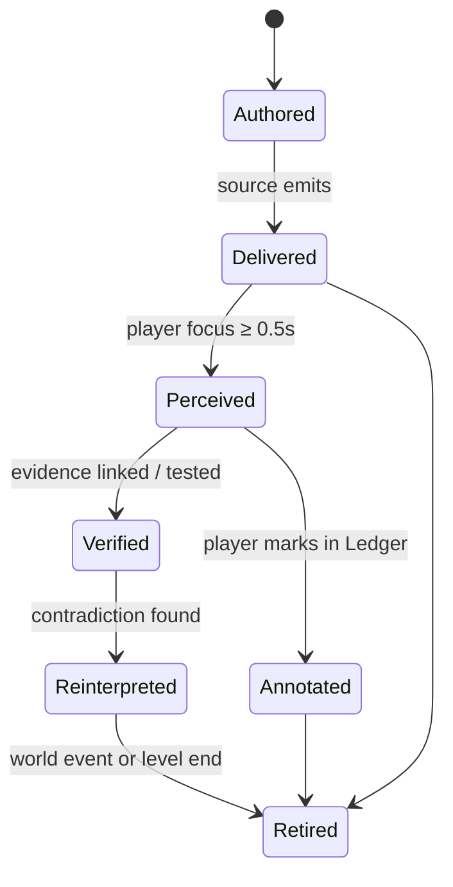

# TRUTH_LIE_SYSTEM

> **Status:** DESIGNED — specification only; not yet implemented in `game/`.

The formal model behind every claim the game makes. Internal categories are **never shown to the player**.

## 1. Statement kinds

| Kind | Example | Evaluated as |
|---|---|---|
| ASSERTION | "Door C leads to the Annex." | Truth category (§2) |
| INSTRUCTION | "Please wait." | Not true/false; carries an **implied claim** evaluated as an assertion |
| PROMISE | "It will open when ready." | Conditional assertion about the future |
| LABEL | Plaque, tag, indicator lamp | Assertion by a source about an object |
| QUOTE | "The record states X." | True *about the document*, not about the world |

## 2. Truth categories

| Category | Definition | Example |
|---|---|---|
| TRUTH | Literal and intended meaning both hold | L03 "Door C leads to the Annex" |
| FALSE | Literal meaning does not hold | L09 "Mirrors cannot be trusted" (false) |
| MISLEADING | Literally true or ambiguous, but intended meaning induces a false belief | L02 "Please wait" (implies waiting helps) |
| INCOMPLETE | True but omits decisive info | L02 "Left door is open" |
| CONTEXTUAL | True only in a specific frame | L06 "Fourth floor above you" |
| TEMPORAL | True for a time window | L07 "Water is safe to touch" |
| TECHNICAL | Literally true under a narrow reading | L05 "No files on the second floor" |
| DECEPTIVE | Intended to create a false belief by any means, incl. framing | L09 Clerk's claim about mirrors |
| UNVERIFIABLE | No in-world verification path exists | Rare; max 1 per act, never progress-critical |

Categories may overlap in design notes but each statement stores one **primary** category plus optional `secondary[]` tags.

## 3. Statement metadata (schema v1)

| Field | Type | Description |
|---|---|---|
| `id` | StringName | `STM-Lxx-nnn` |
| `source_id` | StringName | e.g. `SRC_CLERK_VOICE` |
| `kind` | enum | §1 |
| `text_key` | String | Localization key |
| `intended_meaning` | String (design) | What the speaker wants believed |
| `literal_claim` | Dictionary | Structured claim: `{subject, predicate, object, frame}` |
| `truth_state` | enum | §2 primary |
| `secondary` | Array[enum] | Optional |
| `reliability` | float 0–1 | Source reliability at time of statement |
| `conditions` | Array[Condition] | Flags/time/frame under which it holds |
| `mutable` | bool | Can its truth change? |
| `mutation_events` | Array[StringName] | World events that flip it (must be visible) |
| `verifiable` | bool | Is a verification path present? |
| `verification_paths` | Array[StringName] | Evidence node IDs (≥ 2 when mandatory) |
| `consequence` | Array[StringName] | Tags: `time_loss`, `dead_end`, `soft_gate` |
| `expected_interpretation` | String (design) | What a typical player concludes |
| `variants` | Array[VariantRef] | Surface variants (NG+, adaptive) with identical truth_state |
| `level_id` | StringName | `L05` |
| `introduced_at` / `retires_at` | StringName | Flag or event IDs |
| `progress_critical` | bool | Used by lint |

### Example resource (JSON for readability; stored as `.tres`)

```json
{
  "id": "STM-L05-017",
  "source_id": "SRC_CLERK_VOICE",
  "kind": "ASSERTION",
  "text_key": "L05.clerk.no_files_floor2",
  "intended_meaning": "Player should believe no records are on the upper level.",
  "literal_claim": {"subject": "floor_2", "predicate": "contains", "object": "files", "negated": true, "frame": "numbered_floor"},
  "truth_state": "TECHNICAL",
  "secondary": ["INCOMPLETE"],
  "reliability": 0.55,
  "conditions": [],
  "mutable": false,
  "verifiable": true,
  "verification_paths": ["EVD-L05-CATALOG-2M", "EVD-L05-LADDER-WEAR"],
  "consequence": ["time_loss"],
  "expected_interpretation": "There are no files above the first floor.",
  "progress_critical": true
}
```

## 4. Sources and voice signatures

| Source | Target truth mix | Tell(s) (not absolute) | Notes |
|---|---|---|---|
| `SRC_CLERK_VOICE` | 55% TRUTH, 25% TECH/INCOMPLETE/CONTEXTUAL, 20% FALSE/DECEPTIVE | "As far as the record shows" → incomplete (≈75%); "I assure you" → deceptive (≈60%) | Cannot alter literal text of past statements |
| `SRC_CLERK_SLIP` | Same as voice, slightly more literal | Typed slips quote the record | QUOTE kind common |
| `SRC_PLAQUE` | 90% TRUTH (as of install date) | Weathering = older | Becomes TEMPORAL if world changed |
| `SRC_MARGIN` | ~65% accurate | Handwriting pressure (urgent → wrong more often) | Wrong about frames, not malicious |
| `SRC_DISPATCH` | 90% TRUTH in operator frame | Always references "operator side" | Appears to contradict Clerk |
| `SRC_REFLECT` | 100% TRUTH | Slight cyan cast | Subverts expectation |
| `SRC_ECHO_PELL` | 30% TRUTH | Over-precise numbers | Self-serving |
| `SRC_ECHO_HADDAD` | 80% TRUTH, times wrong | Hedges ("about") | Honest, mistaken |
| `SRC_PANEL` | Systematic 1-step lag | Lag observable | Consistent bias |
| `SRC_ASSIST` | 100% TRUTH | Visually out-of-world | Never part of puzzle logic |

**Tell rule:** no tell may exceed 80% predictive accuracy, so players can lean on them but not mechanize them.

## 5. Evaluation model

A statement's **current truth** is a function of its stored category and the world:

```
evaluate(statement, world) -> Evaluation
  if statement.kind == QUOTE:      holds = quoted_document_matches(statement)
  elif statement.truth_state == TEMPORAL:  holds = all(c.holds(world) for c in conditions)
  elif statement.truth_state == CONTEXTUAL: holds = literal_holds(frame=statement.literal_claim.frame)
  else: holds = baseline[statement.truth_state]   # TRUTH=true, FALSE=false, etc.
  return Evaluation(holds, statement.truth_state, evidence_nodes_in_scene)
```

`Evaluation` is used for **gameplay gating and QA**, never for player-facing UI.

## 6. Statement lifecycle



**Delivered statements are immutable.** Reinterpretation creates a *new* statement ID that references the old (`reinterprets: STM-...`).

## 7. Reinterpretation rules (the Clerk's constraint)

When a lie is exposed, the Clerk may respond only with a statement whose `literal_claim` is **logically consistent** with the original literal text (e.g., L05: "I said floor, not mezzanine."). Authoring tool checks consistency by comparing `subject/predicate/object/frame`.

## 8. Evidence graph

- **Evidence nodes** (`EVD-*`): observable facts (marks, objects, sounds, states) with a location and a *detail layer*.
- **Edges:** `supports(statement)` / `contradicts(statement)`.
- Each `progress_critical` statement that is not TRUTH must have ≥ 2 independent contradicting/clarifying nodes reachable **before** the player needs to act on the statement.

## 9. Fair-play rules (lint-enforced)

| ID | Rule | Lint check |
|---|---|---|
| **R1** | Every non-TRUTH progress-critical statement has ≥ 2 verification paths available before it gates progress | Graph reachability |
| **R2** | Lie introduction ladder obeyed (LEVEL_DESIGN §1) | Level index vs category first-appearance |
| **R3** | Each source has a stable voice signature; tells ≤ 80% predictive | Statistical check over authored data |
| **R4** | **Inversion test:** inverting all statements in a level never solves it; ≤ 40% progress-critical statements non-true | Simulated solver |
| **R5** | False guidance costs ≤ 90 s to detect and recover; no permanent loss without checkpoint | Authored `consequence` tags + playtest |
| **R6** | Each puzzle has a documented deduction chain with ≥ 2 independent evidence nodes | Presence check |
| **R7** | A statement flips only via a visible, attributable world event | Mutation events logged in Change Journal |
| **R8** | Deception never depends solely on color or audio | Evidence node must have ≥ 1 non-color and ≥ 1 non-audio channel, or an accessibility equivalent |
| **R9** | Real UI (Settings, Accessibility, Save/Load, captions) never lies | Code review + UI test |
| **R10** | The Clerk's overall truthfulness remains ≥ 50% by count | Aggregate lint |
| **R11** | At least one TRUTH-when-lie-expected beat per act | Level metadata |
| **R12** | Captions describe the **sound heard**, not the world (a heard door is captioned as a heard door) | Caption review |
| **R13** | **Style parity:** truthful and non-truthful carriers of the same source share identical typography, color, layout, animation and sound design; falsity is never visually or audibly coded. Tells come only from source voice signatures (§4) and evidence nodes | Asset/UI review + style diff check |
| **R14** | **Deceptive UI budget:** ≤ 4 registered deceptive UI instances (UI_UX_REVIEW §6); never in Settings, Pause, Save/Load, captions or notifications | Registry check |

## 10. Public API (frozen for Phase 2 stub)

```gdscript
class_name TruthService extends Node

# Signals are declared on EventBus only (statement_delivered, statement_reinterpreted); see TECHNICAL_ARCHITECTURE §6.

func deliver(statement_id: StringName, context: Dictionary = {}) -> void
func evaluate(statement_id: StringName) -> Evaluation   # internal/QA only
func get_variant(statement_id: StringName) -> VariantRef
func on_world_changed(change_id: StringName) -> void
func link_evidence(a: StringName, b: StringName, relation: StringName) -> void  # Ledger
func get_ledger_view() -> LedgerView                     # topology, no verdicts
func export_state() -> Dictionary
func import_state(d: Dictionary) -> void
```

The Phase 2 stub implements `deliver`, `evaluate`, `export_state`, `import_state` with category lookups only.

## 11. Authoring workflow

1. Writer drafts statements in a spreadsheet (CSV) with all §3 fields.
2. `tools/dialogue_tools/truth_import.py` (planned, Python) converts CSV → `.tres` resources in `res://resources/game_data/statements/`.
3. `res://scripts/utilities/lint/truth_lint.gd` (planned; run headless with `godot --headless --path game --script res://scripts/utilities/lint/truth_lint.gd`) runs R1–R14 and outputs a report.
4. Level designer attaches statements to carriers (`StatementCarrier` nodes).

## 12. Edge cases

| Case | Handling |
|---|---|
| Player never hears a statement | Re-deliverable via Ask; same truth state |
| Two statements conflict by design | Both must have distinct sources and an evidence node that disambiguates |
| Statement referencing earlier variant | Resolved through `reinterprets` chain |
| NG+ variant swap | Variant may change surface text and carrier, not `literal_claim` or truth_state, unless `ng_plus_override` is set and linted |

## 13. Acceptance criteria

- 25 sample statements pass lint on paper before Phase 1 ends.
- A QA engineer can determine for any statement: who said it, how to verify it, and what it costs to be fooled.
