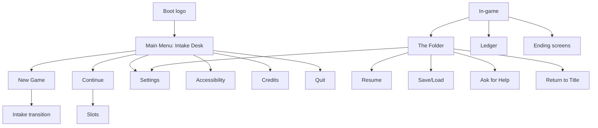

# UI_UX_DESIGN

> **Status:** DESIGNED — specification only; not yet implemented in `game/`.

**Concept:** the UI is the Concord's stationery. Menus are paperwork; the HUD is nearly absent.

## 1. Principles

1. Diegetic first, minimal overlay.
2. Text is sparse; typography carries tone.
3. **The real UI never lies** (R9). Deceptive UI exists only as in-world props.
4. Every screen works with keyboard, mouse and controller.
5. Every animation has a Reduced Motion variant.

## 2. Information classification

| Info | Class | Where |
|---|---|---|
| Clerk statements | Diegetic (voice, slips, plaques) | World |
| Objectives | Diegetic (instruction, marginalia, light) | World |
| Interaction dot | Diegetic-adjacent (brass reticle) | Screen center |
| Verb label | Non-diegetic (short, delayed) | Near reticle |
| Captions | Non-diegetic (accessibility) | Bottom |
| Ledger | Diegetic (notebook) | Tab |
| Pause menu | Diegetic skin (the Folder) | Esc |
| Assist help | Non-diegetic, out-of-world | Folder → Help |
| Panels (L13) | **Intentionally deceptive** diegetic prop | World |
| Fake credits (L17) | **Intentionally deceptive** authored sequence | Screen |
| Settings/Accessibility/Save | Non-diegetic **truthful** | Folder |

## 3. Screen inventory and flow

| Screen | Spec |
|---|---|
| **Main menu** | The *Intake Desk*: a live 3D desk with six distinct objects (ticket machine = New Game, filing drawer = Continue, Regulations binder = Settings, Accommodations form = Accessibility, Staff Register = Credits, Sign-out sheet = Quit). Idle: dust motes, clock tick. After finishing the game the desk gains an ending-specific object. Layout and behavior: UI_COMPONENT_SPEC §5.1. A linear "Simple menu" option exists in Accessibility. |
| **New Game** | Ticket machine prints a ticket; transition to L01. Confirm overwrite via paper form. |
| **Continue** | Drawer of file folders, one per slot with in-game time, level name, ending flag (no spoiler beyond that). |
| **Settings** | Tabs on paper: Video, Audio, Controls, Gameplay, Language. |
| **Accessibility** | Dedicated tab group; reachable from first launch (prompt on first boot). |
| **Save/Load** | Folder slot UI; autosave indicator = small stamp glyph. |
| **Pause (Folder)** | World dims and blurs; the Folder opens in center. Time paused. |
| **Inventory** | None (single carry slot). |
| **Objective system** | None as HUD. Optional **Case Notes** page in Ledger lists *what you have inferred*, not instructions. |
| **Interaction prompts** | Brass dot; verb after 0.6 s focus; hold ring for hold-to-use. |
| **Dialogue presentation** | Clerk voice with captions; slips are readable objects. |
| **Puzzle feedback** | Physical (animation, sound, light); no checkmarks. |
| **Error states** | Paper "Notice of Difficulty" slip: save failed, file corrupt, controller disconnected (with plain language). |
| **Loading** | Diegetic transitions; fallback: ticket machine "Processing" strip with progress. |
| **Credits** | Typed credit slips on a conveyor; skippable. |
| **Ending screens** | Epilogue scenes + stamp summary card. |
| **Secret interfaces** | Corroborate ending; "Second Reading" menu stamp; title screen after endings. |

## 4. HUD

Default HUD = **nothing**, except: reticle dot, delayed verb label, captions (if enabled), autosave stamp (1.2 s). A *High-visibility HUD* option adds: larger reticle, outline highlights, objective hints from Assist.

## 5. Ledger UX

- Opens as a notebook rising into view; the camera then aligns so the page is flat and pixel-aligned 1:1; world dims.
- Left page: sources and statements (grouped by source icon). Right page: evidence and links.
- Controls: navigate (D-pad/arrow), Mark (A/Enter), Link (hold + select), Note (rare).
- No truth verdicts. Provenance stamps: *where* and *when*.
- Performance: the Ledger is a 2D `CanvasLayer` screen; the 3D notebook is only the transitional presentation (UI_COMPONENT_SPEC §5.9).

## 6. Interaction feedback

| Event | Feedback |
|---|---|
| Focus | Dot scales 1→1.25, brass glow |
| Examine | FOV ease −12°, object edge lift (soft), subtle audio swell |
| Use | Physical animation + sound; haptic on controller (light) |
| Wrong attempt | Mechanism "resists" (small shake, dull sound) |
| Right attempt | Mechanism completes with resolved tone |

## 7. Controller UI

Focus rings are stamped outlines. Glyph sets: Xbox, PlayStation, Switch, Generic (auto-detected; user override). Radial not used.

## 8. Localization

All strings by key; Clerk text may expand ~30%; slips/plaques are *textures with text layers* → generated from loc keys by a build step (no baked text in textures).

## 9. Acceptance criteria

- No screen shows more than 5 interactive elements at once (except Settings).
- Any menu can be completed via controller only.
- Text scale 100–150% never clips (tested).

## 10. Authoritative detail

| Topic | Where |
|---|---|
| Tokens, type scale, spacing, components, states, screens, notification system, loading, captions | UI_COMPONENT_SPEC |
| Color language, diegetic audit, deceptive-UI register (DUI-1..4), per-level composition, anti-generic rules | UI_UX_REVIEW |
| Camera, framing, reveals, cinematic moments | CINEMATIC_DIRECTION |
| Review gates | VISUAL_POLISH_CHECKLIST |

Deceptive UI is limited to the four registered instances; Settings, Pause, Save/Load, captions and notifications never deceive (TRUTH_LIE_SYSTEM R9, R13, R14).
