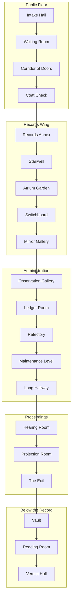

# WORLD_BUILDING

> **Status:** DESIGNED — specification only; not yet implemented in `game/`.

## 1. The Concord

**Full name:** Concord Municipal Hall of Records and Testimony. Founded 1962. Civic modernist: travertine, oak veneer, brass, frosted glass, fluorescent tubes over tungsten lamps. Era is deliberately unfixed (rotary phones next to a barcode-less ticket machine; no screens anywhere except in-world panels).

**Core conceit:** the building records everything a citizen says. Statements are physical objects here: stamped, filed, tubed, engraved.

## 2. Geography

## 3. In-world rules (the building's logic)

| Rule | Meaning for design |
|---|---|
| **Statements are objects.** | Every important claim has a physical carrier (voice via intercom, slip, plaque). |
| **The record cannot be edited, only amended.** | The Clerk may reinterpret but not change the literal text of past statements. |
| **Stamps are authority.** | SERVED / FILED / AMENDED / VOID stamps appear in puzzles and the finale. |
| **The building tends toward consistency.** | Contradictions cause Drift in the zone (presentation anomalies). |
| **Time is clerical.** | Clocks can disagree; the *record* time and *world* time are different frames. |
| **Doors respect procedure.** | Many locks respond to correct order or understanding, not keys. |

## 4. Departments and iconography

| Department | Motif | Colors | Props |
|---|---|---|---|
| Intake | Ticket numbers, brass bell | Paper, brass | Ticket machine, desks, banker lamps |
| Records | Index cards, ladders | Green, oak | Card catalogs, ladders, rolling stacks |
| Administration | Ledgers, switchboards | Grey, brass | Switchboard, dining tables, panels |
| Proceedings | Exhibits, reels | Oxblood, dark oak | Benches, projector, evidence trays |
| Below | Bare concrete, original book | Concrete, amber | Vault door, dictaphone, single lamp |

**Recurring signs:** NOTICES SERVED WITHOUT FAIL SINCE 1962 (plaque, L01; appears worn in later levels); number **4471** (ticket, coat tag, lamp panel label — never emphasized).

## 5. Glossary (in-world terms)

| Term | Definition |
|---|---|
| Witness | The visitor/player. |
| Intake | The first processing of a Witness. |
| Entry | A line in the record. |
| Amend | Restore an entry to its true state. |
| Affirm | Reconfirm an entry as written. |
| Expunge | Destroy an entry. |
| Drift | Zone instability (see §6). |
| Echo | A remembered figure. |
| The Folder | The Clerk's pause menu. |

## 6. Drift model

| Level | Name | Presentation | Used in |
|---|---|---|---|
| D0 | Stable | Consistent light, geometry, UI | L01 |
| D1 | Murmur | Light flicker ≤ 2% intensity, 1–2 prop positions differ on revisit | L02–L04 |
| D2 | Slip | Reflections incorrect; sound/vision mismatch; small scale changes | L05–L09 |
| D3 | Fray | Diegetic UI anomalies; text changes while peripheral | L10–L14 |
| D4 | Fold | Impossible spaces, loops, non-Euclidean connections | L06, L14, L16–L17 |
| D5 | Collapse | Structural failure, paper blizzard, fire reflections | L20 (Expunge/Affirm) |

Drift is **presentation-only** unless an authored world event says otherwise. Accessibility: D2+ effects respect *Reduced Motion* and *Reduced Flashing* (ACCESSIBILITY).

## 7. History (background layers, found in props)

- 1962: Concord opens; plaque installed.
- 1971: Pneumatic tube network added.
- 1989: Backlog crisis; supervisor memos introduce "clear by Friday".
- Record 4471: Alder Court (the event).
- After: Building preserved "as found" (the in-game place is the preserved state).

## 8. Environmental storytelling checklist

Each wing must contain: 1 hidden human trace (note, lunch bag, stained cup), 1 institutional trace (memo, stamp pad, tube slip), 1 wrongness trace (misaligned object, mismatch). Never more than 3 readable items per room beyond puzzle-critical text.

## 9. Acceptance criteria

- A level artist can read this and place props in a way that matches the department's motif.
- Every Drift level has an ID usable by VFX/Audio.
